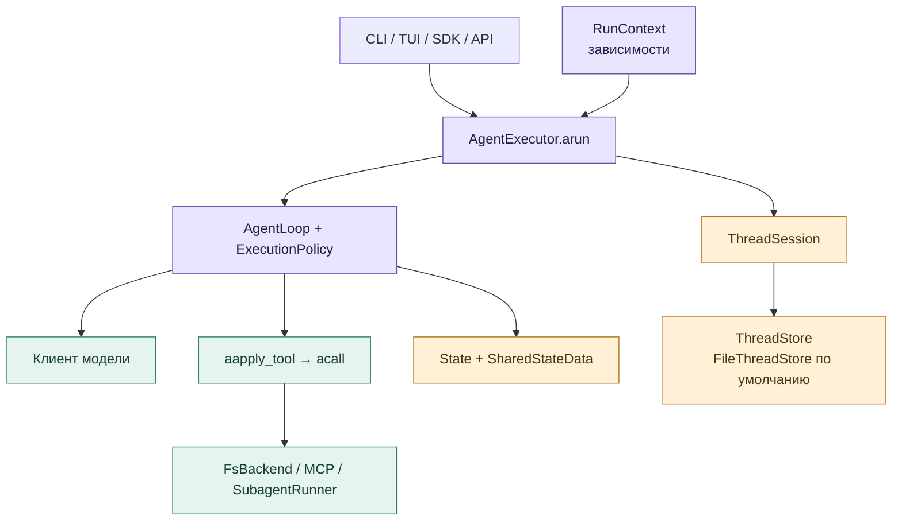
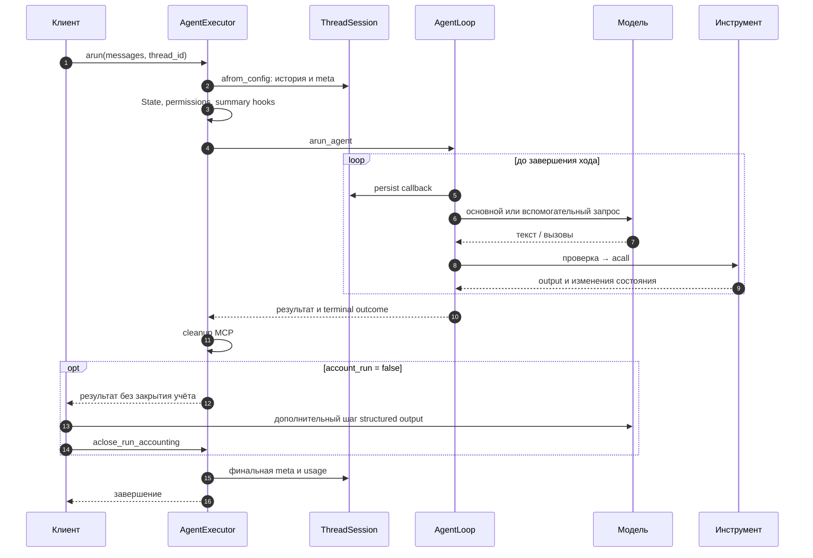
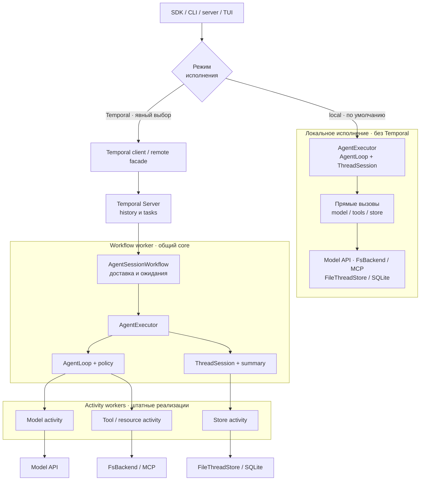
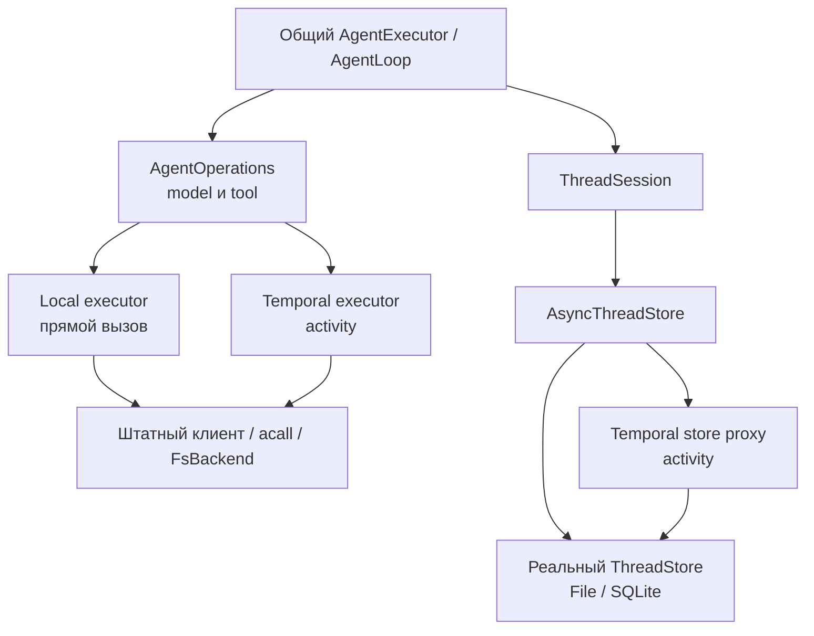
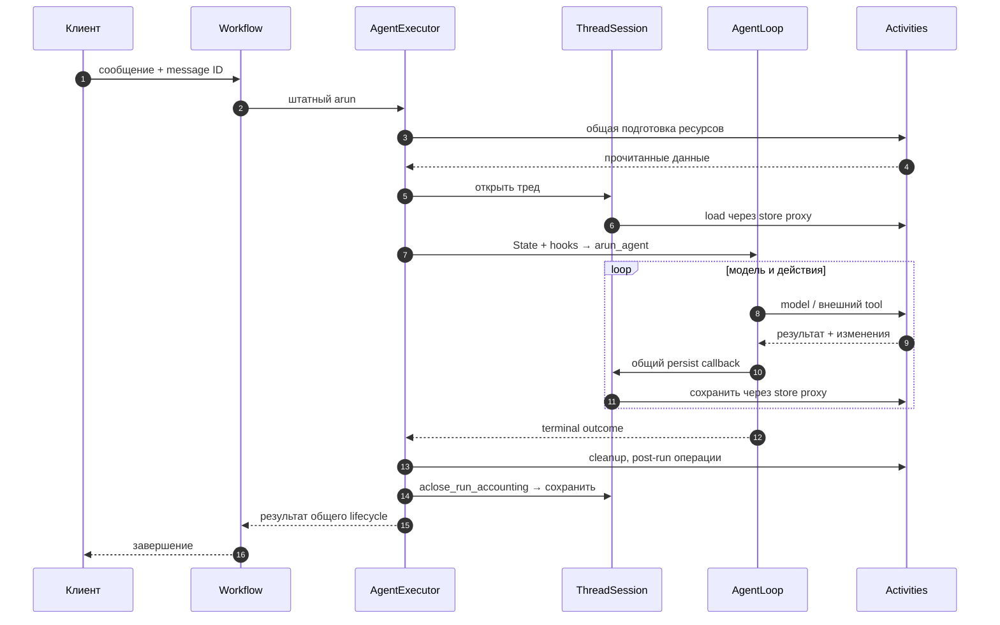
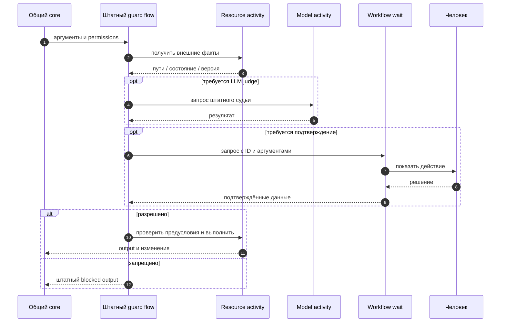
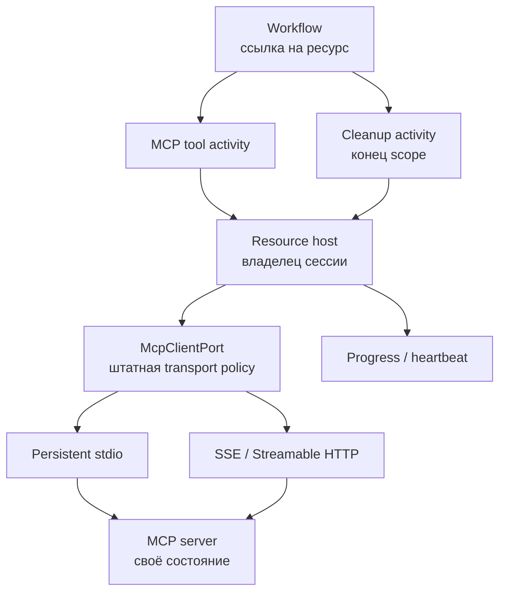
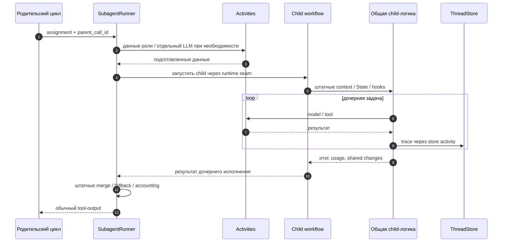
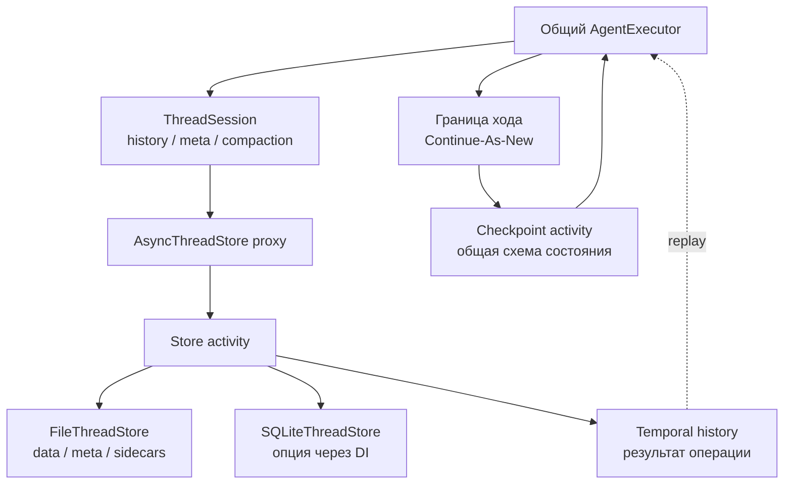

# Universal Agent: нативная интеграция с Temporal

**Статус: нативный путь реализован в рабочей ветке, общая приёмка продолжается.**
База сравнения — `develop` от 01.10.2026, commit `3e7f98e3`.
Раздел 0 описывает обычный агент; **разделы 1–13 — согласованный проект и
целевая схема**, включая ещё не принятые свойства. Их формулировки не являются
перечнем уже реализованных гарантий. **Раздел 14 сопоставляет проект с текущими классами, командами,
проверками и оставшимися ограничениями.** Схемы показывают логические границы:
отдельные очереди ещё не означают развёртывание в независимых процессах.

Основное решение: **один `AgentExecutor`, один `ThreadSession`, один агентский цикл**.
Меняется исполнитель внешних операций. Пакет `gc-ua-temporalio` связывает штатное
ядро с workflow и activities; бизнес-правила остаются в `gc_core`.
Pydantic AI для исполнения нашего агента не используется.

**Temporal — опциональный backend исполнения.** Штатный запуск через SDK, CLI,
server или TUI остаётся локальным по умолчанию и не обращается к Temporal Server.
Workflow и activities появляются только при явном выборе Temporal-режима.

В схемах слова «model activity», «store proxy», «resource activity» обозначают
**архитектурные роли**. Фактические имена activities и ссылки на реализацию
приведены в разделе 14. Старый экспериментальный workflow обслуживается отдельно.

Для просмотра отдельно и вставки в Outline:

| Схема | PNG | SVG |
|---|---|---|
| Штатный агент: компоненты | [Открыть](diagrams/temporal/00-agent-components.png) | [Открыть](diagrams/temporal/00-agent-components.svg) |
| Штатный агент: один ход | [Открыть](diagrams/temporal/00-agent-turn.png) | [Открыть](diagrams/temporal/00-agent-turn.svg) |
| Целевые процессы и границы | [Открыть](diagrams/temporal/01-architecture.png) | [Открыть](diagrams/temporal/01-architecture.svg) |
| Общие порты операций | [Открыть](diagrams/temporal/02-dispatch.png) | [Открыть](diagrams/temporal/02-dispatch.svg) |
| Ход после переезда | [Открыть](diagrams/temporal/03-turn.png) | [Открыть](diagrams/temporal/03-turn.svg) |
| Guards и подтверждения | [Открыть](diagrams/temporal/04-guards.png) | [Открыть](diagrams/temporal/04-guards.svg) |
| Persistent MCP | [Открыть](diagrams/temporal/05-mcp.png) | [Открыть](diagrams/temporal/05-mcp.svg) |
| Дочернее исполнение | [Открыть](diagrams/temporal/06-child.png) | [Открыть](diagrams/temporal/06-child.svg) |
| Сохранение и replay | [Открыть](diagrams/temporal/07-persistence.png) | [Открыть](diagrams/temporal/07-persistence.svg) |

## 0. Как устроен штатный агент без Temporal

### 0.1. Основные классы

Клиент передаёт сообщения исполнителю. `AgentExecutor` открывает тред, создаёт
состояние хода и запускает общий цикл. Модель предлагает текст или инструменты;
цикл проверяет результат, исполняет действия и передаёт outputs следующему запросу.
«Локальное исполнение» здесь означает процесс цикла: модель, MCP и workspace
могут находиться удалённо.

| Класс / функция | Ответственность и связи |
|---|---|
| [`AsyncAgent`](../packages/core/src/gc_core/aio/agent.py) | SDK-фасад: создаёт контекст и исполнителя, принимает ввод, отдаёт ответ и события. CLI/TUI также используют ядро через свои фасады. |
| [`acreate_run_context`, `RunContext`](../packages/core/src/gc_core/run_context.py) | Подготовка config, logger, tools, router, skills, MCP, `os_backend`, workspace и callbacks. Уже поддерживает внедрение `thread_store`. |
| [`AgentExecutor`](../packages/core/src/gc_core/agent_executor.py) | Жизненный цикл: `_aopen_thread_session`, `_abuild_run_state`, persist/summary hooks, `arun`, teardown, `aclose_run_accounting`. Управление: `add_message`, `stop_run`, `take_undelivered_messages`. |
| [`State`](../packages/core/src/gc_core/states.py), [`SharedStateData`](../packages/core/src/gc_core/execution/state.py) | Messages, usage, счётчики, intent, stop и общие memory/permissions. Новый `State` создаётся на каждый ход; сохраняемые поля восстанавливаются из треда. |
| [`arun_agent`](../packages/core/src/gc_core/processing_responses.py), [`AgentLoop`](../packages/core/src/gc_core/execution/loop.py) | Общий цикл: `_astep`, `_aprepare_batch`, `_adispatch`; pending messages, лимиты, hooks и завершение. |
| [`ExecutionPolicy`](../packages/core/src/gc_core/execution/policy.py) | `aprocess_user_ask`, `aprocess_tool_calls`, `aprocess_tool_outputs`: обработка batches, pairing вызовов и outputs, обратная связь, последовательность инструментов. |

### 0.2. Один штатный ход

Схема показывает путь с подключённым тредом; без `thread_id` его сохранение
отсутствует. Summary и finish judge могут обращаться к модели между основными
шагами. Один проход цикла обрабатывает режим `user_ask`, `function_call`,
`function_call_output` или `text_response`; он не равен всему запросу пользователя.

При обычном `account_run=True` исполнитель закрывает учёт сам. При дополнительном
post-run шаге вызывающий использует `account_run=False`, затем вызывает
`aclose_run_accounting()`. Отмена во время MCP teardown после завершившегося цикла
не должна потерять его итог и usage; cancellation пробрасывается после сохранения.

### 0.3. Модель, инструменты и остальные подсистемы

| Компонент | Что делает сейчас |
|---|---|
| [`ModelRouter.resolve`](../packages/core/src/gc_core/model_router.py) | Выбирает профиль модели для consumer. Основные запросы идут через `processing_responses`; вспомогательные — через [`llm_chat_client`](../packages/core/src/gc_core/utils/llm_chat_client.py). Новый `arequest_chat_completion_outcome` возвращает text и finish reason. |
| [`abuild_tools_data`, `aapply_tool`](../packages/core/src/gc_core/tools/__init__.py) | Готовят каталог и схемы, проверяют аргументы, создают `tool_fabric`, вызывают `acall`. `aapply_tool_result` возвращает output и явные изменения memory/todo; полная изоляция всех остальных инструментов ещё не выполнена. |
| [`FsBackend`](../packages/core/src/gc_core/backends/protocol.py), [`ExecutionWorkspace`](../packages/core/src/gc_core/execution_workspace.py) | Файлы и команды в выбранной среде. Workspace содержит проектные файлы; это отдельное состояние от истории разговора. |
| [`ThreadSession`](../packages/core/src/gc_core/thread_store.py), [`ThreadMetaMapper`](../packages/core/src/gc_core/persistence/thread_meta_mapper.py) | История, meta, известные ключи сообщений, previous response ID и компакция. Mapper переносит shared/state в meta и обратно. |
| [`FileThreadStore`](../packages/core/src/gc_core/thread_store_file.py), [`AsyncThreadStore`](../packages/core/src/gc_core/thread_store_async.py) | Хранение через общий порт. По умолчанию `data_*.jsonl`, `meta_*.json`, trace/служебные файлы; можно внедрить другую реализацию. |
| [`RunSummaryCoordinator`](../packages/core/src/gc_core/run_summary_coordinator.py) | Проверяет pre-run, pre-backend, turn-end и force-компакцию; вызывает модель и сохранение через `ThreadSession`. |
| [`SkillsRegistry`](../packages/core/src/gc_core/tools/skills/registry.py) | Штатные instructions и packs: discovery, источник, namespace, priority skill и содержимое инструкций. |
| [`PermissionStore`](../packages/core/src/gc_core/security/permission_store.py), [`FinishGateGuard`](../packages/core/src/gc_core/intent_guard/guard.py) | Первый хранит решения доступа сессии; второй проверяет достаточность финального ответа. Это разные политики. |
| [`McpClientPort`](../packages/core/src/gc_core/tools/connect_mcp/client_port.py), [`SubagentRunner`](../packages/core/src/gc_core/tools/subagents/runner.py) | MCP discovery/calls и создание дочернего исполнения. У субагента собственные контекст, роль, лимиты и итог; часть shared-данных общая с родителем. |

Очередь поступает через `add_message()`, stop — через `stop_run()`.
Необработанный хвост возвращает `take_undelivered_messages()`. Продолжение треда
в локальном режиме создаёт новый ход на сохранённых данных; файловое хранилище
не сохраняет стек Python, HTTP-запрос или живую MCP-сессию.

## 1. Целевые процессы и границы исполнения — проект

После добавления интеграции сохраняются два пути. **Local — штатный путь по умолчанию:**
frontend запускает `AgentExecutor` в локальном runtime, без Temporal. **Temporal —
явно выбранный backend:** frontend использует Temporal client / remote facade,
а workflow выполняет адаптированный штатный `AgentExecutor`.
В этом режиме на worker activities остаются реальные клиенты и ресурсы. Их можно разместить
в одном процессе или распределить по очередям, но workflow всегда получает
сериализуемые данные, а не HTTP-клиент, lock, сокет или файловый дескриптор.

Две ветки используют одну реализацию core; на схеме показаны разные места
её исполнения. SDK / CLI / server / TUI сами по себе не означают Temporal.
Установка пакета интеграции или доступность Temporal Server не переключает backend
автоматически. Обычный server по-прежнему может запускать локального агента
на серверной машине — «local» здесь означает отсутствие Temporal orchestration.

На схеме стрелки core → activity обозначают планирование через Temporal Server,
а не прямой вызов другого процесса. Результат завершённой activity фиксируется
в execution history. После рестарта workflow повторяет общий код и получает
записанный результат в той же точке.

Неизменённый `AsyncAgent.create()` нельзя просто поместить внутрь workflow.
В самом `run_context.py` предстоит отделить загрузку конфигурации, prompts,
skills, discovery и создание ресурсов от чистой сборки зависимостей.
Обе среды используют эти общие функции; второго bootstrap агента не будет.

## 2. Как общий код выбирает исполнителя операции — проект

Используем существующие [`AgentOperations`](../packages/core/src/gc_core/execution/ports.py)
и `AsyncThreadStore`, расширяя контракт там, где сейчас теряются нужные данные.
Названия local/Temporal executors на схеме — роли зависимостей, не новые агенты.
Таблица ниже уточняет границы именно **Temporal-режима**. В local эти операции
вызываются напрямую штатным runtime; activities и workflow waits не создаются.

| Операция | Целевая граница и результат |
|---|---|
| Основная и вспомогательная модель | Отдельная activity на LLM-вызов; messages/text, reasoning, finish reason, usage, response ID и нужные metadata возвращаются общему коду. |
| Внешний инструмент | Activity вызывает штатный инструмент и backend. Output/errors и изменения принадлежащих инструменту данных возвращаются явно. |
| Memory / todo | Общая чистая функция может выполниться внутри workflow; изменения сохраняет обычный `ThreadSession`. |
| История и meta | `ThreadSession` вызывает свой async store. Temporal-прокси планирует activity, worker обращается к выбранному store. |
| Файлы подготовки, skills, traces | Явная resource/store activity; прочитанные данные фиксируются до применения. |
| Человек / дочерний агент | Workflow wait / child workflow соответственно; это не длительно занятые tool activities. |

Внутри уже запущенной tool activity `FsBackend.exists/read/write/exec` работают
обычным способом. Activity на каждый внутренний `stat` не нужна. Если файловый
вызов инициирует сам workflow, он обязан пройти отдельную I/O-границу.

## 3. Ход агента после переезда — проект

`AgentExecutor` сохраняет порядок штатных действий: свежий `State`, снятие
stale flags, MCP snapshot, skills, permissions, pre-run summary, подхват очереди,
цикл, cleanup и учёт. Temporal не собирает свою урезанную версию этих шагов.

Updates/Signals доставляют сообщения и stop в общие точки управления.
Сообщение может попасть в текущий batch, следующий ход либо undelivered-хвост
по правилам core. Подтверждение принятия сообщения не означает завершение хода.
`stop` — кооперативный запрос; уже совершённый внешний эффект не откатывается
от отмены ожидающей корутины.

Время, ID, ожидания и синхронизация получают явные зависимости среды исполнения.
`threading.Lock`, реальный clock, `asyncio.to_thread` и прямой filesystem I/O
не должны случайно вызываться при replay.

## 4. Guards: модель, человек и внешний эффект — проект

Штатные guards уже используют общий поток в
[`dual_wrapper.py`](../packages/core/src/gc_core/security/dual_wrapper.py).
Его предстоит адаптировать: текущие `OffLoop`/`AwaitOnCaller` содержат callable,
а [`request_confirm`](../packages/core/src/gc_core/security/confirm_port.py)
ориентирован на текущие клиентские callbacks. Их нельзя сериализовать как activity input.

Правила read/write/URL/command guard остаются в core. Каждый judge проходит
через model activity; ожидание человека не удерживает worker. После подтверждения
проверяются актуальные предусловия эффекта: согласие на одни аргументы не даёт
разрешения на изменившиеся цели или содержимое.

Сохраняются `PermissionStore`, session grants, формат ошибок и варианты тулов,
включая `backup` и `make_dirs`. Нынешние дополнительные отказы Temporal-демо
не становятся новым контрактом агента. Инфраструктурную ошибку или cancellation
нельзя поймать широким `except Exception` и превратить в разрешение fail-open.
При этом допустимые provider/domain errors обрабатываются по прежней политике
конкретного consumer. Если штатный judge допускает fail-open для такой причины,
он сохраняется. Adapter должен отличать эту причину от failure самой Temporal-операции,
отмены и нарушения гарантий хранения; произвольный `ActivityError` не является
эквивалентом «judge недоступен».

## 5. Persistent MCP и потоковые транспорты — проект

Переиспользуются `McpClientPort`, `AgentRuntimeClient`, discovery и
[`PersistentStdioRegistry`](../packages/core/src/gc_core/tools/connect_mcp/persistent_stdio.py).
Живое соединение принадлежит resource host. Workflow хранит идентификатор
и поколение сессии; activity направляется туда, где ресурс доступен.

Перезапуск workflow worker и падение самого MCP host — разные события.
Первое позволяет продолжить с живой внешней сессией. Во втором случае обычное
переподключение не восстанавливает память MCP-сервера, открытый браузер или процесс.
Нужна поддержанная процедура resume/rebuild либо явная ошибка потери сессии.

Scope и cleanup сохраняют штатные границы запуска. SSE, progress и heartbeat
показывают ход работы, но не доказывают завершение эффекта. При неизвестном исходе
stateful tools автоматический повтор запрещается до проверки результата.

## 6. Субагенты используют штатный SubagentRunner — проект

У [`SubagentRunner`](../packages/core/src/gc_core/tools/subagents/runner.py)
свои подготовка роли, лимиты, fallback, обработка stop и построение результата.
Их сохраняем. Меняем точку запуска child: локальный вызов или child workflow
общей дочерней логики. Подмена ребёнка обычным `AgentExecutor.arun()` без этой
семантики создала бы ещё одно расхождение.

Между процессами нельзя передать `SharedStateData` по ссылке. Передаются
необходимые данные и явные изменения, которые применяет общий код с определённым
порядком. Проверяются permissions, memory, usage, `parent_call_id`, trace и ввод
во время работы ребёнка. Роль, prompts и схемы не пересобираются отдельно в Temporal.

## 7. Настоящий ThreadSession, файловое хранилище и replay — проект

Первый сквозной срез выполняется с обычным `FileThreadStore`. SQLite остаётся
реализацией того же хранилища через SDK/worker DI, а не обязательным условием
Temporal. Хранилище диалога, журнал внешних эффектов и Temporal Server persistence
выполняют разные задачи, даже если физически используют одну БД.

`ThreadSession.apersist_batch()` сегодня делает append, чтение meta и запись meta.
Activity сама по себе не делает эту последовательность атомарной. Общий контракт
предстоит дополнить устойчивой операцией batch с operation ID и квитанцией:
транзакцией для SQLite, блокировкой и восстанавливаемым журналом для файлов.

Прокси сохраняет мутации `known_keys`/`session_meta`, `max_seq` и исходный `written`.
После retry нельзя вернуть «записано 0», если исходная попытка уже записала batch:
счётчики `ThreadSession` должны получить первоначальный результат. Также через
порт проходят reset/discard, runtime flags, архивирование, replacement и sidecars.
Operation ID, исходная квитанция и восстановление нужны всем этим изменениям.
Общий механизм recovery/ownership обязателен и для CLI/TUI/API readers/writers:
иначе они смогут увидеть промежуточное состояние append/meta или обойти владельца.

Replay восстанавливает исполнение из Temporal history. ThreadStore сохраняет
продуктовую историю; workspace остаётся у FsBackend. Потерянный диск Temporal
самостоятельно не восстановит. Для первой версии предполагается устойчивый
workspace host с явным владением, а не обещание произвольного multi-host failover.

Continue-As-New выполняется на безопасной границе завершённого хода и handlers.
Переносятся очередь, message deduplication, ссылки на тред, counters и checkpoint
по общей схеме состояния. UI retention нельзя использовать вместо полного checkpoint.

## 8. Что именно меняем в существующих классах — проект

| Существующее место | Адаптация для общей архитектуры |
|---|---|
| `acreate_run_context`, `State.acreate` | Отделить внешние чтения и live resources; оставить единственную сборку config, prompts, tools и состояния. |
| `AgentExecutor.arun` | Внедрить зависимости исполнения; сохранить setup, pending/stop, summary, teardown и accounting в одном методическом пути. |
| `AgentLoop`, `ExecutionPolicy` | Сохранить batches, pairing, лимиты и feedback; применять результаты операций через общую логику. |
| `processing_responses`, `llm_chat_client` | Все main/text/outcome и вспомогательные запросы через model port; сохранить router, Responses, retries и metadata. |
| `aapply_tool_result`, классы tools | Уточнить явные результаты и state changes; сохранить схемы, validation, dropped args и error envelopes. |
| `ThreadSession`, `AsyncThreadStore` | Activity-прокси по существующему контракту, устойчивые записи и единое владение; никаких обходных file helpers из workflow. |
| `RunSummaryCoordinator` | Те же пороги и hooks; чистые проверки внутри workflow, LLM и сохранение через порты. |
| `dual_wrapper`, guards, `confirm_port` | Возобновляемые общие стадии guard, отдельная модель, async human decision и эффект. |
| `McpClientPort`, `SubagentRunner` | Явный resource/child execution seam при сохранении штатной подготовки и результатов. |

[`ModelRequest`, `ModelResult`, `ToolResult`](../packages/core/src/gc_core/execution/contracts.py)
уже существуют в эксперименте, но их полнота подлежит проверке. Текущий
`StateDelta` для memory/todo недостаточен для permissions, shared child changes
и других эффектов. Новый контракт не должен молча обрезать состояние до удобного набора.

Разделение подготовки пока неполное: `State.__init__` через `set_call_metadata` /
`build_instructions` ещё читает инструкции и генерирует ID. Передавать подготовленные
значения нужно в существующую сборку `State`; одного наличия `State.acreate` недостаточно.

Локальный SDK сохраняет свой контракт. Удалённый фасад явно предоставляет снимки,
запросы состояния и подтверждения доставки; он не передаёт живой `executor`, mutable
`State` или `threading.Lock`. Семантика этих локальных объектов не обещается через сеть.
Пользовательские structural stores продолжают работать локально по прежнему контракту,
в том числе без optional replace. Temporal заранее проверяет durable capabilities
или совместимый adapter; отсутствие гарантий не приводит к тихому local fallback.

## 9. Что убираем из нынешнего Temporal-пути — проект

| Нынешний компонент | Почему меняем |
|---|---|
| [`SessionEngine`](../packages/temporalio/src/gc_ua_temporalio/session.py) | Дублирующий lifecycle возвращается в `AgentExecutor`. Workflow остаётся доставкой событий и механизмом ожиданий. |
| [`WorkerRuntime._context/bootstrap`](../packages/temporalio/src/gc_ua_temporalio/runtime.py) | Отдельная ручная сборка заменяется штатными функциями подготовки. |
| [`ThreadProjection`](../packages/core/src/gc_core/execution/projection.py) как workflow-сессия | Используется настоящий `ThreadSession`; чистые helpers могут остаться общей внутренней деталью, без второго пути persistence. |
| [`AgentSessionWorkflow._persist`](../packages/temporalio/src/gc_ua_temporalio/workflow.py) | Самостоятельная сборка meta уступает обычному persist callback и `ThreadSession`. |
| Особые summary/bindings/guarded tools | Политики возвращаются к штатным coordinator, bindings и guards. Урезанные tools и `unsupported`-заглушки не являются целевой интеграцией. |
| Обязательная SQLite в worker | Store внедряется через DI; operational journals отделяются от хранения разговора. |

Удаление происходит после проверки нового пути. Старые workflow histories
нельзя незаметно исполнять новым порядком команд: новая версия получает отдельное
исполнение, а старые истории остаются доступны и при необходимости обслуживаются
старым worker. Миграция треда выполняется явно на завершённой границе.

## 10. Что пришло из develop и должно сохраниться — проект

| Изменение | Требование после переезда |
|---|---|
| [`Structured output`](../packages/cli/src/gc_cli/structured_output.py) | Чтение текстовой формы через I/O-границу; дополнительный model call до закрытия учёта. Это не JSON Schema. Ошибка/truncation не становятся успешным финальным результатом. |
| `ChatCompletionText` / outcome helper | Сохранять text, finish reason и usage; новый outcome-путь тоже направить через model port. |
| `account_run=False`, `aclose_run_accounting` | Финальная meta после дополнительных шагов, единожды; storage error видна вызывающему. Переформатирование не подменяет исходную историю. |
| MCP teardown cancellation | Сохранить завершённый результат перед пробросом отмены; не приписать успех незавершившемуся циклу. |
| Harbor reasoning | Не терять `reasoning_content` при нормализации ответа, сохранении и экспорте траектории. |
| Skills packs | Сохранить root `pack.yaml`, source/namespace, bootstrap и priority task skill через штатный registry. |
| TUI retention | Оставить политикой отображения; полный контекст модели, export и checkpoint не сокращаются UI-лимитом. |

Форма structured output читается и проверяется **до запуска агента**: неверный путь
не должен обнаруживаться после платных model calls или внешних эффектов. Для remote
запуска фиксируется содержимое на клиентском preflight либо используется preparation
activity с тем же доступом к источнику. Путь из cwd клиента не является путём worker;
replay использует зафиксированные данные.

## 11. Повторы, ошибки и наблюдаемость — проект

| Ситуация | Целевая семантика |
|---|---|
| Завершённая activity записана в history | Replay получает тот же результат, не выполняет внешнюю операцию заново. |
| Модель ответила, worker упал до фиксации | Возможен повтор запроса и дополнительная стоимость. Exactly-once обращения к провайдеру не обещаем. |
| Read activity не завершилась | Retry может увидеть изменившийся файл или API; завершённый результат затем фиксируется. |
| Write/append/command/MCP с неизвестным исходом | Idempotency key или проверка эффекта; иначе явный `UNKNOWN`, без слепого повтора. |
| Ошибка storage или инфраструктуры | Не превращается в обычный tool-output, fail-open guard или успешное окончание. |
| Streaming | Preview помечается operation/attempt/sequence; каноническую историю определяет завершённый результат. |

Operation identity включает тред, ход и вызов. Общая task queue не смешивает
контекст агентов; live resources и изменяемый breaker также должны иметь явный
scope. Секреты разрешаются на worker и не становятся данными history.

Число activities измеряем по типам. Пустая проверка summary-порога остаётся
обычной функцией. Необходимую запись треда сохраняем ради её гарантий, а не
удаляем для похожего на другой framework количества строк в UI.

## 12. Как поймём, что переезд завершён — проект

1. **Одна архитектура:** local и Temporal действительно вызывают общий `AgentExecutor`,
   `ThreadSession`, summary, tools и guards. Тест проверяет путь исполнения, а не
   только похожий финальный ответ.
2. **Совместимость с новым develop:** одинаковые fixtures и записанные ответы модели
   дают одинаковые prompts, schemas, provider requests, outputs, errors, историю,
   meta, usage и изменения workspace после нормализации времени/ID.
3. **Полная функциональность:** два хода, pending/stop, все стадии summary, finish judge,
   guards/confirmations, backup/make_dirs, Responses cache miss, stored outputs,
   MCP transports, child traces, skills и structured output проверены явно.
4. **Корректные границы:** sandbox и I/O-sentinels обнаруживают прямые file/network/process
   операции из workflow. Внутри tool activity не спрятаны отдельный LLM или human wait.
5. **Восстановление:** падения до/после эффекта и до ack, между append/meta, во время
   confirmation, child и MCP проверяются с FileThreadStore и SQLite. Replay и
   Continue-As-New не теряют сообщения, память и учёт.
6. **Качество:** серия одинаковых реальных задач сравнивает успешность, лишние tool errors,
   запросы, токены и потерю контекста. Один удачный прогон не доказывает отсутствия
   ухудшений; каждое систематическое расхождение разбирается до приёмки.

Порядок работы после согласования: эталон → общие порты/контекст/модель →
настоящий ThreadSession → tools/guards → lifecycle/summary → тонкий workflow →
MCP/children → SDK/UI → восстановление и полная приёмка. Документ меняет статус
на «реализовано» только после завершения этих проверок.

## 13. Исследование: какие изменения ядра помогут интеграции — проект

**Предлагается доработать существующий core: явные внешние операции и результаты,
один штатный lifecycle.** Сохраняются async/await, `AgentExecutor`, `ThreadSession`,
общий цикл, guards и `SubagentRunner`. Это предложение для обсуждения, ещё не
реализованная архитектура. Изменения нужны и вне пакета `gc-ua-temporalio`.

### 13.1. Сравнение подходов

| Подход | Что получаем | Оценка для UA |
|---|---|---|
| Только activity-обёртки вокруг модели, tool и store | Небольшой первый пример; скрытые чтения, вложенные judges, общие мутации и locks остаются. | Недостаточно для полного агента; есть риск снова обходить штатные функции. |
| Уточнить границы существующего core | Те же правила и handlers; внешние вызовы и изменения состояния выражены явно; local и Temporal выбирают исполнителя. | **Рекомендуется.** Поэтапные изменения с проверкой local parity. |
| Новый event-sourced/state-machine framework | Своя модель событий, переходов, runtime и схема миграций поверх Temporal. | Для этой задачи не обоснован; существенно больше изменений и риска для поведения. |

### 13.2. Конкретные изменения и польза для локального агента

| Где | Предлагаемое изменение | Польза без Temporal |
|---|---|---|
| `RunContext`, подготовка `State` | Отделить прочитанные данные и конфигурацию от живых клиентов, backend, locks и callbacks; убрать скрытый I/O из сборки состояния. | Воспроизводимые prompts, проще тесты и понятное владение ресурсами. |
| `AgentOperations`, model helpers | Один handler запроса для всех consumers, полные result/usage/metadata и явная передача router state. | Одинаковая подмена провайдера в main loop, judge, summary и post-run. |
| `ToolResult`, общая обработка tools | Возвращать реальные изменения состояния; применять их в одном месте, без замены всего `State` снимком. | Видны изменения permissions/memory/todo, меньше случайных мутаций чужой сессии. |
| `dual_wrapper`, guards | Сохранить правила; отделить facts, judge, human wait и effect. | Отдельно тестируются политика, отказ, отмена и внешний эффект. |
| `ThreadSession`, `AsyncThreadStore` | Использовать готовый DI; укрепить квитанции и recovery всех mutation operations, с соблюдением ownership читателями и писателями. | FileThreadStore тоже получает понятное восстановление прерванной записи. |
| `AgentExecutor`, control flow | Оставить pending/stop/undelivered в общем core, отделить способ доставки и синхронизации. | Сохраняются правила SDK; проще проверять гонки и teardown. |
| Errors/retries | Сохранить политику consumer для domain errors; отдельно передавать cancellation и ошибки исполнения/хранения. Назначить владельца транспортного retry. | Не теряются причины ошибки, попытки не перемножаются между слоями. |
| `McpClientPort`, `SubagentRunner` | Явный владелец ресурсов, восстановление и возврат shared changes. | Понятный cleanup и поведение при потере процесса/соединения. |

Не требуется превращать весь код в чистые функции или неизменяемые объекты.
Детерминированные closures и генераторы могут остаться внутри workflow: replay
повторяет их исполнение. Через activity-границу передаются данные; сохранять Python
stack и создавать собственный интерпретатор guards не нужно. Для простого внешнего
tool его штатный `FsBackend` работает внутри activity — отдельная activity на каждый
`open` не нужна.

### 13.3. Что показывают другие интеграции

В Pydantic AI 2.42.0 прежний `TemporalAgent` объявлен deprecated в пользу
`TemporalDurability` на обычном `Agent`. Общий durable core сохраняет исходный
handler, выбирая обычный вызов или bound operation. Для UA это поддерживает выбор
единого ядра с заменяемым исполнителем, но не требует копировать capability framework.
[Исходник wrapper](https://raw.githubusercontent.com/pydantic/pydantic-ai/v2.42.0/pydantic_ai_slim/pydantic_ai/durable_exec/temporal/_agent.py),
[общий durable core](https://raw.githubusercontent.com/pydantic/pydantic-ai/v2.42.0/pydantic_ai_slim/pydantic_ai/durable_exec/_base.py).

Экспериментальный Deep Agents plugin Temporal оставляет цикл в workflow, оборачивая
внешние tools и backend-операции. Применение к UA — явные порты в нашем core и выбор
границы по реальному эффекту. Guard с дополнительной моделью и подтверждением
требует нескольких шагов, а не одной большой tool activity.
[Deep Agents plugin, SDK 1.33.0](https://raw.githubusercontent.com/temporalio/sdk-python/1.33.0/temporalio/contrib/deepagents/README.md).

Практики нельзя переносить целиком: Pydantic описывает MCP connect/close внутри
каждой activity; persistent-сессиям UA нужны собственные правила владения и
восстановления. Reconnect не восстанавливает память MCP-сервера.
[Pydantic: Temporal и MCP](https://pydantic.dev/docs/ai/capabilities/durable_execution/temporal/).

### 13.4. Порядок и граница изменений

Сначала меняем общие границы в **local-режиме** и проверяем поведение на эталоне
develop. Затем подключаем Temporal к тем же функциям. Самые существенные риски —
семантика storage, порядок guards и shared state детей; их нельзя оценить одним
успешным ответом модели.

В эту миграцию не включаются ради удобства универсальный event bus, effect DSL,
полностью immutable State, CRDT, новая параллельность детей или обязательный переход
всех пользователей на SQLite. Новые DTO и адаптеры добавляются для конкретных
границ, а бизнес-правила остаются в единственном общем пути.

Практическая проверка архитектуры: если новая фича develop требует повторить
сборку prompt, summary или завершение хода отдельно в Temporal-пакете, общее ядро
ещё не доведено до нужной границы. Исследование обосновывает предложенный путь,
но не заменяет проверку совместимости и качества на нашем агенте.

## 14. Реализация в рабочей ветке

### 14.1. Какой вход запускает какой цикл

| Вход | Поведение |
|---|---|
| Обычный `AsyncAgent`, CLI, TUI и server с настройками по умолчанию | Обычный локальный `AgentExecutor`; Temporal не нужен. |
| `gc-temporal-native`, `NativeAgentClient` | Явно запускают `NativeAgentWorkflow`. |
| Server с `execution_backend: temporal-native` | `NativeRunRegistry` создаёт native workflow; удалённые CLI/TUI используют HTTP API этого server. |
| Server с прежним `execution_backend: temporal` | Старый экспериментальный workflow; его истории и серверный режим не переключены автоматически. |

См. [конфигурацию и команды запуска](temporal-configuration.md). Native worker
стартует из папки своего workspace. FileThreadStore или SQLiteThreadStore выбирается
в профиле. Каталог тредов и базу технических квитанций рекомендуется размещать **вне
рабочей папки агента**: иначе они становятся частью видимого модели окружения.

### 14.2. Классы и реальные вызовы

| Компонент | Что вызывает и зачем |
|---|---|
| [`NativeAgentWorkflow`](../packages/temporalio/src/gc_ua_temporalio/native_workflow.py) | `_prepare_turn` → подготовка контекста, `assemble_native_context`, настоящий `AgentExecutor`. `_run_turn` → `AgentExecutor.arun`, общий structured output, accounting, освобождение ресурсов. Внешний цикл доставляет сообщения и выполняет Continue-As-New между ходами. |
| [`NativeOperations`](../packages/temporalio/src/gc_ua_temporalio/native_operations.py) | Реализация портов модели, фактов guards, эффектов инструмента, prompts, skills и project memory через `workflow.execute_activity`. Детерминированные правила остаются в общем ядре. |
| [`NativeActivities`](../packages/temporalio/src/gc_ua_temporalio/native_activities.py) | Вызывает реальные worker-side функции ядра. `_recorded` повторно отдаёт записанный результат; эффекты имеют отдельный журнал исходов. |
| [`NativeContextProvider`](../packages/temporalio/src/gc_ua_temporalio/native_provider.py) | `acreate_run_context` с полной закреплённой конфигурацией; хранит живые контексты и ресурсы, отдаёт workflow только подготовленные данные. `close` закрывает ресурсы, `release` удаляет контекст после accounting. |
| [`assemble_native_context`](../packages/temporalio/src/gc_ua_temporalio/native_context.py) | Использует общую сборку `RunContext` и реальные классы инструментов. Ресурс, вызванный в обход внешнего порта, выдаёт ошибку. Logger — replay-aware `workflow.logger`. |
| [`NativeSubagentWorkflow`](../packages/temporalio/src/gc_ua_temporalio/native_child_workflow.py), [`NativeChildTransport`](../packages/temporalio/src/gc_ua_temporalio/native_child_transport.py) | Переносят запуск настоящего `SubagentRunner` в child workflow; возвращают результат, usage и изменения shared/permissions. Сообщения, подтверждения и stop маршрутизируются активному ребёнку. |
| [`WorkerResourceHost`](../packages/core/src/gc_core/execution/resource_host.py) | Владеет настоящими persistent MCP/background ресурсами; последовательные вызовы используют ту же сессию. Потеря владельца не означает автоматическое восстановление памяти MCP. |
| [`NativeCheckpointActivities`](../packages/temporalio/src/gc_ua_temporalio/native_checkpoint.py) | Неизменяемые delivery chunks и manifest в технической receipts DB; восстановление больших CAN snapshots с проверкой SHA256. |
| [`NativeOperatorActivities`](../packages/temporalio/src/gc_ua_temporalio/native_operator.py), [`NativeClosedRecovery`](../packages/temporalio/src/gc_ua_temporalio/native_closed_recovery.py) | Проверяют неопределённые исходы и evidence; фиксируют решение без повторного внешнего эффекта, отдельно освобождают fence terminal run. |
| [`NativeRunRegistry`](../packages/temporalio/src/gc_ua_temporalio/native_registry.py), [`NativeViews`](../packages/temporalio/src/gc_ua_temporalio/native_views.py) | HTTP управление и чтение фактического File/SQLite store; отдельные технические события — только preview/UI. Cursor обнаруживает замену истории при compaction. |

`ThreadSession` остаётся штатным объектом ядра. Его async store proxy планирует I/O
на выбранном настоящем FileThreadStore/SQLiteThreadStore; SQLite-проекция вместо
файлового треда не создаётся. Отдельная SQLite-база содержит квитанции операций,
журнал эффектов и технические события, а не вторую политику памяти агента.

### 14.3. Что видно в Temporal UI

| Activity type | Граница операции |
|---|---|
| `agent.context.prepare`, `agent.state.prepare`, `agent.prompts.prepare` | Чтение окружения и подготовка данных для штатного контекста/State. |
| `agent.model.request` | Один вызов общего модельного порта: main, judge, summary, роль или structured output. Подпись показывает назначение. |
| `agent.guard.probe` | Внешние факты и предусловия. Решение guard, judge и ожидание человека не спрятаны внутри tool activity. |
| `agent.tool.execute` | Штатный внешний эффект инструмента, включая MCP; подпись содержит имя инструмента. Несколько файловых syscall одного инструмента остаются внутри этой activity. |
| `agent.thread.load`, `agent.thread.commit` | Чтение и изменение выбранного store; подпись указывает вид операции. |
| `agent.prompt.read`, `agent.skills.list`, `agent.memory.execute`, `agent.memory.hash`, `agent.summary.trace` | Остальные явные обращения к внешнему окружению. |
| `agent.delivery.put`, `agent.delivery.seal`, `agent.delivery.get` | Большие delivery checkpoints между runs; малые snapshots остаются inline. |
| `agent.operator.inspect`, `agent.operator.resolve`, `agent.operator.result` | Явная проверка и подтверждение неопределённого результата. |
| `agent.context.close`, `agent.context.release` | Закрытие ресурсов и освобождение worker-контекста после учёта результата. |

Тип activity стабилен; её ID связывает конкретную операцию с квитанцией, а `summary`
даёт читаемую подпись без содержимого файлов, prompts и credentials.
Чистые изменения memory/todo не требуют tool activity.

Оптимизация `reset_run_flags`: один атомарный сброс служебных флагов заменяет
последовательные записи. В контрольном запуске число activities изменилось
**26 → 24**, событий истории **161 → 149**; commit **12 → 11**, load **3 → 2**.
Число модельных запросов и инструментальных действий осталось прежним.
Это сравнение одной оптимизации нашего workflow, а не доказательство превосходства
над другими фреймворками с иными границами сохранения.

### 14.4. Проверено и что ещё нельзя обещать

Основная реализация и автоматическая проверка рабочего среза выполнены;
приёмка всех свойств проектных разделов 1–13 не объявляется. Последний полный
core + CLI suite после исправления command judge: **6542 passed, 3 skipped**.
В общем Temporal-прогоне прошли 277 тестов, один обнаружил незавершение legacy
child при недоступной модели. Ошибка исправлена: восемь повторных/добавленных
проверок прошли, включая этот child, production native worker без расширенного
тестового списка failure exceptions, command judge File/SQLite, ENV config и
remote TUI. Store/checkpoint/HITL gate после финальных helper-правок:
43 passed. Полный server suite: 309 passed; выбранные TUI store/lock/diff
проверки: 67 passed. Проверки кода (Ruff, complexity, Sonar-like, dead code,
duplicate code) пройдены. Результаты общего и целевых прогонов учитываются отдельно.

Проверены неизменённые 44 локальных эталонных traces относительно develop и
реальные HTTP local/native сценарии на FileThreadStore и SQLite: prompts,
запросы модели, результаты/ошибки tools, порядок, usage, память и файлы.
Отдельные сценарии включают calculator/batches, неверные arguments/unknown tools,
FS append/backup/mkdir/download/stored outputs, finish gate reject/accept,
project memory и structured output. Автоматическая суммаризация проверена на
pre-run по символам, pre-backend по токенам, четырёх incremental batches и
реальном XML repair; turn-end и ручная session compaction имеют отдельные gates.
Native replay не вызывает модель или инструменты повторно.

Chat Completions JSON и SSE проверены отдельно. Responses проверен на двух ходах
и потере `previous_response_id`. Исправлены общие проблемы прежнего пути:
`backend.completions_url` используется, если legacy `agent_url` отсутствует;
cache-miss классифицируется по прочитанному HTTP body; reasoning items остаются
в истории и не считаются tools. Command judge получает реальный непустой
`never_touch_paths` через worker probe: локальные и native HTTP prompts совпадают,
скрытого обращения `Path.home` из sandbox больше нет.

**Хранилище и сбои.** File сохраняет канонические JSONL/meta с общим process lock,
redo recovery и оригинальными квитанциями; SQLite использует одну транзакцию.
Повтор operation ID возвращает исходную квитанцию до проверки текущего fence;
конфликт входа отклоняется. Проверены SIGKILL до commit/после receipt на обоих
stores, отсутствие дублей, rollback и replay. Для модели ответ без записанной
квитанции остаётся неопределённым: exactly-once отправка внешнему провайдеру
не обещается, автоматической повторной отправки такого запроса нет.

**Ресурсы и управление.** Реальные MCP stdio/SSE/Streamable HTTP, parent/child
workflow, HITL и stop покрыты живыми сценариями. SIGKILL persistent MCP/background
owner не создаёт новую сессию и не повторяет подтверждённый эффект. Отмена через
Temporal API во время MCP teardown закрывает scopes в задаче владельца и
отражается как CANCELED после cleanup; обычный сигнал stop имеет свою семантику.
Actor/context caches освобождаются после accounting. Потерянный диск и внутреннее
состояние погибшего MCP-сервера Temporal не восстанавливает.

**Неопределённый исход.** Native workflow переходит в `needs_reconciliation`.
Операторские inspect/resolve/resume проверяют исходные call/result contracts,
digests и owner/revision/generation fence; подтверждённый результат сохраняется
с audit. Это работает и для активного child через root bridge. Ни resolve, ни
resume не вызывают модель/tool повторно. Stop/close оставляют неурегулированный
эффект и fence явно неопределёнными. Для terminal run есть отдельные
inspect-closed/resolve-closed/release-thread: снять fence можно только после
проверки последнего run и отсутствия неразрешённых эффектов всей child lineage.
Новый workflow запускается явно; автоматического восстановления MCP нет.
Подробнее — [операторское восстановление](temporal-configuration.md#native-operator-recovery).

**Большие delivery checkpoints.** До 128 КиБ `NativeResume` остаётся inline;
более крупный snapshot записывается неизменяемыми чанками по 64 КиБ в технический
журнал. Manifest связывает SHA256, длину и namespace workflow/profile/revision/
store/system/thread. Continue-As-New передаёт ссылку; следующий run проверяет
целостность до приёма updates. Проверен реальный CAN со snapshot больше 2 МиБ,
activity payloads меньше 128 КиБ, CAN input меньше 4 КиБ, replay обоих histories
и гонки новых сообщений/ответов/stop/close при upload/restore. Delivery epoch
предотвращает потерю данных между snapshot и CAN.

Это **частичное offload**, а не универсальная отмена Temporal payload limits:
одиночные большие model request/result, query/result и human/message updates
ещё могут превышать предел сервера. Большой checkpoint создаёт число chunks и
событий history пропорционально размеру. Retention/GC старых manifests и
незавершённых uploads пока не реализован.

В текущем deployment один процесс обслуживает все три очереди и один workspace
с совпадающим cwd. Раздельные model/resource процессы, универсальная миграция
активных histories и восстановление утраченного локального диска не заявлены.
Старый SessionEngine сохранён для legacy режима; native его lifecycle не использует.

### 14.5. Живая серия качества и стоимость orchestration

Контрольная серия: одна модель `qwen/qwen3.8-omni-flash`, temperature 0, две задачи
по три повтора в каждом режиме, чередование порядка. Один и тот же абсолютный
workspace восстанавливался перед каждым запуском; служебные stores находились
вне него. Registry и finish gate настроены одинаково.

| Режим | Правильные артефакты | Tools | LLM calls | Input / output tokens | Стоимость, ₽ | Неожиданные tool errors |
|---|---:|---:|---:|---:|---:|---:|
| Local | 6/6 | 39 | 43 | 216254 / 12951 | 2,2807 | 0 |
| Native | 6/6 | 40 | 40 | 200360 / 12477 | 2,0236 | 0 |

Это **12 запусков и ограниченная выборка**, не статистическое доказательство
отсутствия деградации или преимущества native. Последовательности tools могут
различаться даже при temperature 0. Предшествующие серии сохранены: в первой
служебная БД внутри native workspace влияла на модель; без явного абсолютного
workspace оба режима придумывали внешние пути. Исправление условий эксперимента
не выдаётся за доказанное улучшение качества кодом.

Отдельная invoice-задача показывает стоимость выбранных границ orchestration:

| Исполнение | Model activities | Все activities | History events |
|---|---:|---:|---:|
| Pydantic AI, прежний comparison | 6 | 10 | 65 |
| DeepAgents, прежний comparison | 7 | 12 | 76 |
| Universal Agent legacy comparison | 8 | 49 | 307 |
| Universal Agent native | 8 | 52 | 317 |

**52 native против 49 legacy — не сокращение общего числа activities.** Профили,
system prompts и границы guards/persistence у разных фреймворков различаются;
эти числа не ранжируют скорость или качество. В native 23 store commits,
8 guard probes и 8 model activities видимы явно. Контролируемое уменьшение
26 → 24 относится только к `reset_run_flags` на одной и той же scripted
траектории (раздел 14.3). Дальнейшее сравнение стоимости/удобства Temporal UI
остаётся частью приёмки, а не завершённым результатом оптимизации.
