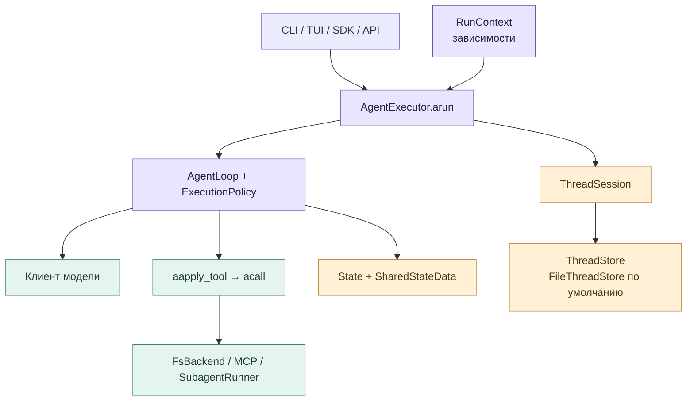
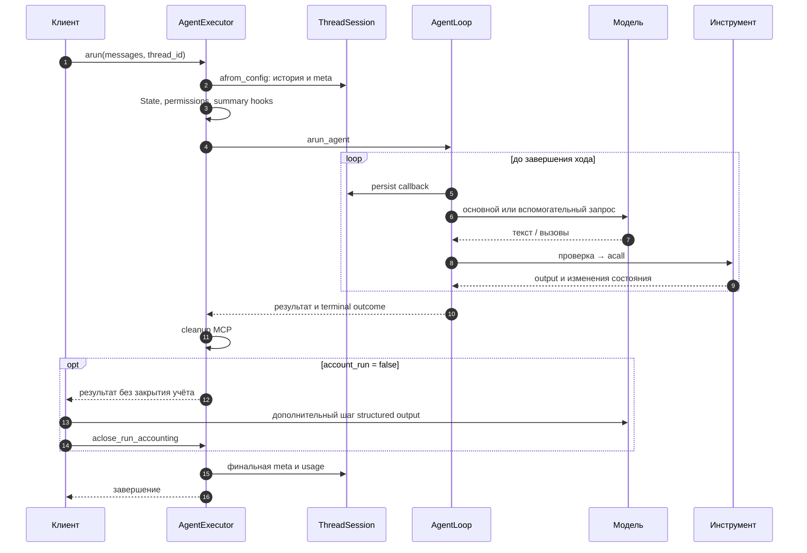
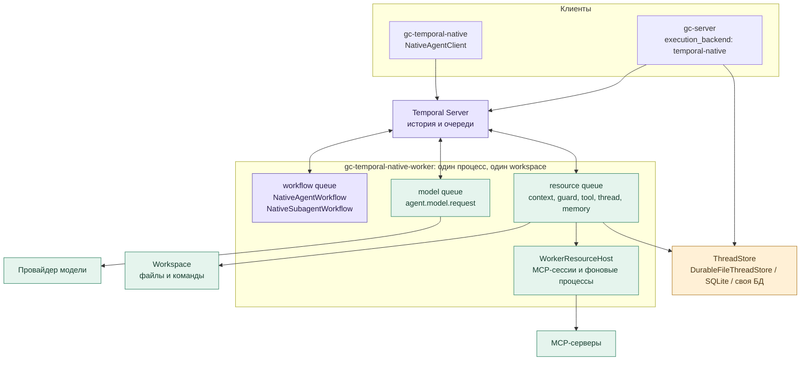
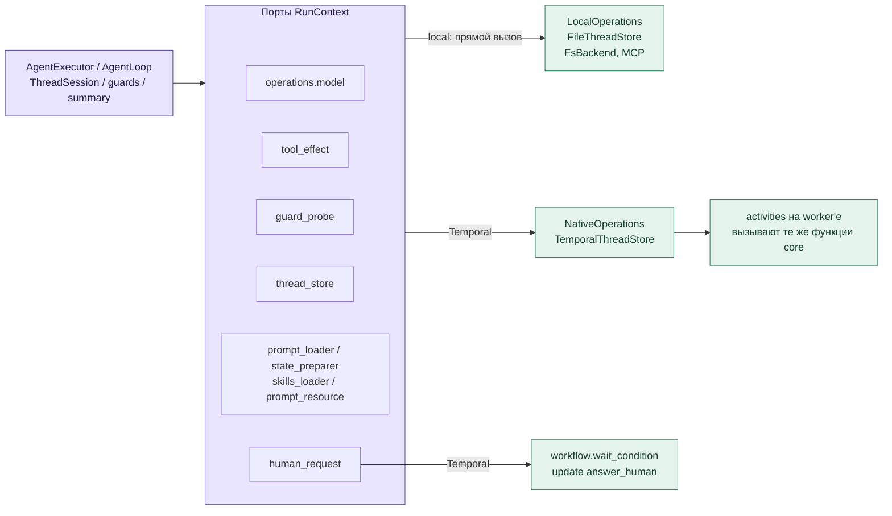
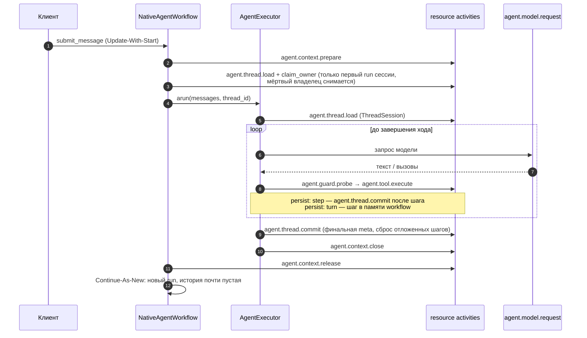
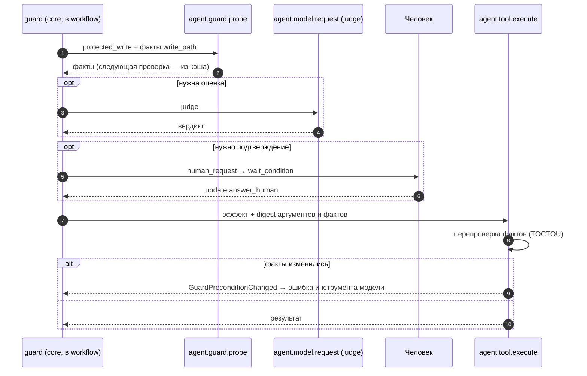
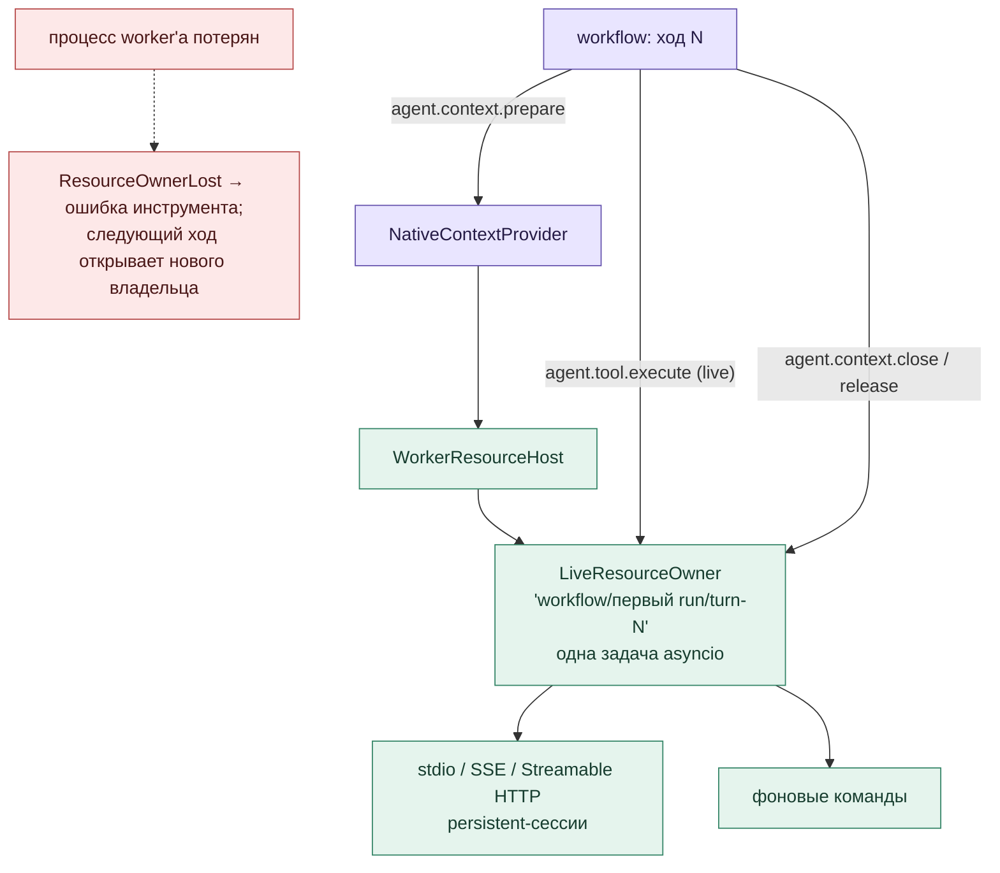
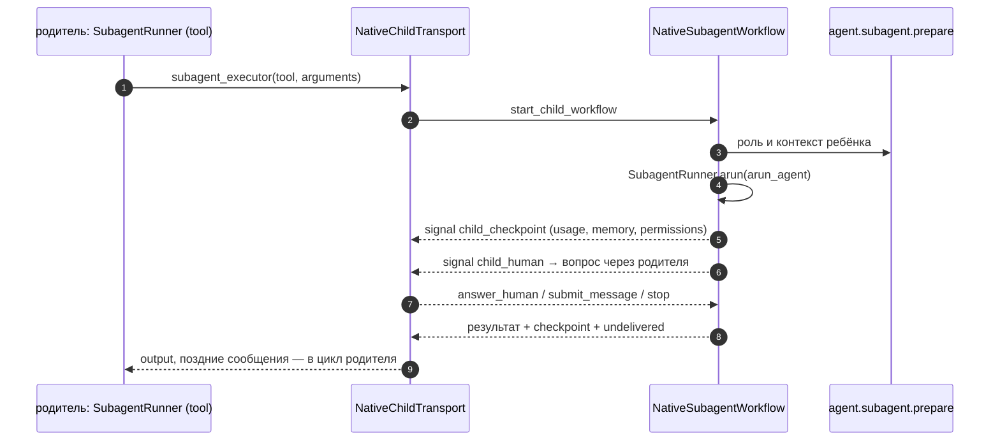
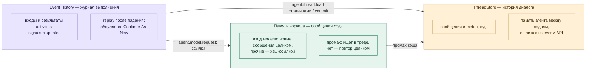

# Universal Agent: нативная интеграция с Temporal

**Статус: реализовано в ветке `feat/temporal-runtime`.** База — `develop`
`8f43bf03` (влит 05.10.2026: изображения, gc-chat); эталон поведения local —
трассы develop `824870f6`. Документ описывает фактические классы, activities и
поведение; итоги проверок — в [разделе 12](#12-проверки), порядок чтения кода — в
[разделе 13](#13-с-каких-файлов-начинать).

Основное решение: **один `AgentExecutor`, один `ThreadSession`, один агентский цикл**.
Temporal меняет только исполнителя внешних операций: модель, внешние эффекты
инструментов, I/O хранилища и подготовку контекста. Пакет `gc-ua-temporalio`
связывает штатное ядро с workflow и activities; бизнес-правила остаются в `gc_core`.
Тот же принцип у Pydantic AI (`TemporalDurability`) и у Deep Agents
(`temporalio.contrib.deepagents`).

**Temporal — опциональный backend.** SDK, CLI, server и TUI по умолчанию работают
локально и к Temporal Server не обращаются. TUI и `gc-cli` работают только локально;
Temporal включается worker'ом `gc-temporal-native-worker`, клиентом
`gc-temporal-native` или server backend `execution_backend: temporal-native`.

## С чего начать изучение

1. **Картина целиком — 15 минут.** Прочитайте вступление выше, затем
   [раздел 0.2](#02-один-штатный-ход) (штатный ход без Temporal) и
   [раздел 3](#3-один-ход) (тот же ход в Temporal). Главная мысль: агентский
   цикл один и тот же, Temporal подменяет только исполнителей внешних операций
   (модель, эффекты инструментов, хранилище) через порты
   [раздела 2](#2-порты-операций-один-код-два-исполнителя).
2. **Запустить и посмотреть.** Поднимите dev-сервер и worker по
   [quickstart](temporal-configuration.md#native-quickstart), отправьте одно
   сообщение клиентом `gc-temporal-native start` и откройте ход в Temporal UI
   (`http://localhost:8233`): каждая activity подписана (`Model: …`, `Tool: …`,
   `Guard: …`, `Thread store: …`) — это и есть таблица
   [Activities](#activities) в живом виде.
3. **Как переживаются сбои.** [Раздел 8](#8-ошибки-повторы-и-неизвестный-исход)
   (что видит модель при падении, что становится FAILED, что ждёт исправленного
   воркера) и [раздел 7](#7-хранение-тред-и-история-temporal) (два
   хранилища: тред и история Temporal).
4. **Код.** Пять файлов из [раздела 13](#13-с-каких-файлов-начинать) по порядку,
   затем тема, которая нужна (guards, субагенты, MCP, хранилища).
5. **Поведение в тестах.** `test_native_workflow_live.py` (ход на настоящем
   Temporal + replay) и `test_native_parity_live.py` (local и Temporal на одних
   ответах модели) — самые короткие исполняемые описания.

Схемы для просмотра отдельно и вставки в Outline:

| Схема | PNG | SVG |
|---|---|---|
| Штатный агент: компоненты | [Открыть](diagrams/temporal/00-agent-components.png) | [Открыть](diagrams/temporal/00-agent-components.svg) |
| Штатный агент: один ход | [Открыть](diagrams/temporal/00-agent-turn.png) | [Открыть](diagrams/temporal/00-agent-turn.svg) |
| Процессы и хранилища | [Открыть](diagrams/temporal/01-architecture.png) | [Открыть](diagrams/temporal/01-architecture.svg) |
| Порты операций: local и Temporal | [Открыть](diagrams/temporal/02-dispatch.png) | [Открыть](diagrams/temporal/02-dispatch.svg) |
| Один ход в Temporal | [Открыть](diagrams/temporal/03-turn.png) | [Открыть](diagrams/temporal/03-turn.svg) |
| Guards, подтверждение и эффект | [Открыть](diagrams/temporal/04-guards.png) | [Открыть](diagrams/temporal/04-guards.svg) |
| MCP и фоновые процессы | [Открыть](diagrams/temporal/05-mcp.png) | [Открыть](diagrams/temporal/05-mcp.svg) |
| Субагент в child workflow | [Открыть](diagrams/temporal/06-child.png) | [Открыть](diagrams/temporal/06-child.svg) |
| Тред и история Temporal | [Открыть](diagrams/temporal/07-persistence.png) | [Открыть](diagrams/temporal/07-persistence.svg) |

## 0. Как устроен штатный агент без Temporal

### 0.1. Основные классы

Клиент передаёт сообщения исполнителю. `AgentExecutor` открывает тред, создаёт
состояние хода и запускает общий цикл. Модель предлагает текст или инструменты;
цикл проверяет результат, исполняет действия и передаёт outputs следующему запросу.
«Локальное исполнение» здесь означает процесс цикла: модель, MCP и workspace
могут находиться удалённо.

| Класс / функция | Ответственность и связи |
|---|---|
| [`AsyncAgent`](../packages/core/src/gc_core/aio/agent.py) | SDK-фасад: создаёт контекст и исполнителя, принимает ввод, отдаёт ответ и события. CLI/TUI также используют ядро через свои фасады. |
| [`acreate_run_context`, `RunContext`](../packages/core/src/gc_core/run_context.py) | Подготовка config, logger, tools, router, skills, MCP, `os_backend`, workspace и callbacks. Уже поддерживает внедрение `thread_store`. |
| [`AgentExecutor`](../packages/core/src/gc_core/agent_executor.py) | Жизненный цикл: `_aopen_thread_session`, `_abuild_run_state`, persist/summary hooks, `arun`, teardown, `aclose_run_accounting`. Управление: `add_message`, `stop_run`, `take_undelivered_messages`. |
| [`State`](../packages/core/src/gc_core/states.py), [`SharedStateData`](../packages/core/src/gc_core/execution/state.py) | Messages, usage, счётчики, intent, stop и общие memory/permissions. Новый `State` создаётся на каждый ход; сохраняемые поля восстанавливаются из треда. |
| [`arun_agent`](../packages/core/src/gc_core/processing_responses.py), [`AgentLoop`](../packages/core/src/gc_core/execution/loop.py) | Общий цикл: `_astep`, `_aprepare_batch`, `_adispatch`; pending messages, лимиты, hooks и завершение. |
| [`ExecutionPolicy`](../packages/core/src/gc_core/execution/policy.py) | `aprocess_user_ask`, `aprocess_tool_calls`, `aprocess_tool_outputs`: обработка batches, pairing вызовов и outputs, обратная связь, последовательность инструментов. |

### 0.2. Один штатный ход

Схема показывает путь с подключённым тредом; без `thread_id` его сохранение
отсутствует. Summary и finish judge могут обращаться к модели между основными
шагами. Один проход цикла обрабатывает режим `user_ask`, `function_call`,
`function_call_output` или `text_response`; он не равен всему запросу пользователя.

При обычном `account_run=True` исполнитель закрывает учёт сам. При дополнительном
post-run шаге вызывающий использует `account_run=False`, затем вызывает
`aclose_run_accounting()`. Отмена во время MCP teardown после завершившегося цикла
не должна потерять его итог и usage; cancellation пробрасывается после сохранения.

### 0.3. Модель, инструменты и остальные подсистемы

| Компонент | Что делает сейчас |
|---|---|
| [`ModelRouter.resolve`](../packages/core/src/gc_core/model_router.py) | Выбирает профиль модели для consumer. Основные запросы идут через `processing_responses`; вспомогательные — через [`llm_chat_client`](../packages/core/src/gc_core/utils/llm_chat_client.py). Новый `arequest_chat_completion_outcome` возвращает text и finish reason. |
| [`abuild_tools_data`, `aapply_tool`](../packages/core/src/gc_core/tools/__init__.py) | Готовят каталог и схемы, проверяют аргументы, создают `tool_fabric`, вызывают `acall`. `aapply_tool_result` возвращает output и явные изменения memory/todo; полная изоляция всех остальных инструментов ещё не выполнена. |
| [`FsBackend`](../packages/core/src/gc_core/backends/protocol.py), [`ExecutionWorkspace`](../packages/core/src/gc_core/execution_workspace.py) | Файлы и команды в выбранной среде. Workspace содержит проектные файлы; это отдельное состояние от истории разговора. |
| [`ThreadSession`](../packages/core/src/gc_core/thread_store.py), [`ThreadMetaMapper`](../packages/core/src/gc_core/persistence/thread_meta_mapper.py) | История, meta, известные ключи сообщений, previous response ID и компакция. Mapper переносит shared/state в meta и обратно. |
| [`FileThreadStore`](../packages/core/src/gc_core/thread_store_file.py), [`AsyncThreadStore`](../packages/core/src/gc_core/thread_store_async.py) | Хранение через общий порт. По умолчанию `data_*.jsonl`, `meta_*.json`, trace/служебные файлы; можно внедрить другую реализацию. |
| [`RunSummaryCoordinator`](../packages/core/src/gc_core/run_summary_coordinator.py) | Проверяет pre-run, pre-backend, turn-end и force-компакцию; вызывает модель и сохранение через `ThreadSession`. |
| [`SkillsRegistry`](../packages/core/src/gc_core/tools/skills/registry.py) | Штатные instructions и packs: discovery, источник, namespace, priority skill и содержимое инструкций. |
| [`PermissionStore`](../packages/core/src/gc_core/security/permission_store.py), [`FinishGateGuard`](../packages/core/src/gc_core/intent_guard/guard.py) | Первый хранит решения доступа сессии; второй проверяет достаточность финального ответа. Это разные политики. |
| [`McpClientPort`](../packages/core/src/gc_core/tools/connect_mcp/client_port.py), [`SubagentRunner`](../packages/core/src/gc_core/tools/subagents/runner.py) | MCP discovery/calls и создание дочернего исполнения. У субагента собственные контекст, роль, лимиты и итог; часть shared-данных общая с родителем. |

Очередь поступает через `add_message()`, stop — через `stop_run()`.
Необработанный хвост возвращает `take_undelivered_messages()`. Продолжение треда
в локальном режиме создаёт новый ход на сохранённых данных; файловое хранилище
не сохраняет стек Python, HTTP-запрос или живую MCP-сессию.

## 1. Процессы, очереди и хранилища

| Элемент | Что это |
|---|---|
| [`NativeAgentWorkflow`](../packages/temporalio/src/gc_ua_temporalio/native_workflow.py) | Сессия: очередь сообщений, ответы человека, stop/close, один ход за run. Внутри хода — настоящий `AgentExecutor.arun`. |
| [`NativeSubagentWorkflow`](../packages/temporalio/src/gc_ua_temporalio/native_child_workflow.py) | Субагент: настоящий `SubagentRunner.arun` в child workflow. |
| [`native_worker`](../packages/temporalio/src/gc_ua_temporalio/native_worker.py) | Один процесс обслуживает все три очереди и один workspace; cwd должен совпадать с `profiles.<name>.workspace`. |
| [`NativeContextProvider`](../packages/temporalio/src/gc_ua_temporalio/native_provider.py) | Собирает на worker'е штатный `acreate_run_context` по профилю воркера: workflow знает только имя профиля (как Pydantic AI — модель по ключу реестра). Смена настроек или токена — перезапуск воркера, живые сессии продолжают работу. |
| [`NativeMaintenance`](../packages/temporalio/src/gc_ua_temporalio/native_maintenance.py) | Фон воркера раз в 10 минут: освобождает контекст хода, чей workflow уже не исполняется (terminate посреди хода), вместе с MCP-процессами; чистит служебные записи журнала тредов старше 7 дней. |
| ThreadStore | История диалога. `DurableFileThreadStore`, `SQLiteThreadStore` или своя реализация durable-контракта ([раздел 7](#7-хранение-тред-и-история-temporal)). По умолчанию — каталог `threads` в `state_dir` (по умолчанию — каталог конфига воркера), не в workspace агента. Своей базы у воркера нет: результаты activities хранит история Temporal. |
| [`native_activity_config`](../packages/temporalio/src/gc_ua_temporalio/native_activity_config.py) | Таймауты и повторы activities по уровням (`model`, `resource`, `thread_store`, инструмент) — как `ActivityConfig` у Pydantic AI; в workflow приходят с подготовкой хода. |
| [`message_refs`](../packages/temporalio/src/gc_ua_temporalio/message_refs.py) | Вход activity модели: новые сообщения целиком, уже переданные и прочитанные из треда — хэш-ссылкой; воркер держит сообщения хода в памяти. Вместе со страничным чтением треда и потолком вывода инструмента (1 МБ) держит записи истории меньше лимита Temporal (2 МБ) без отдельного хранилища payload. |

## 2. Порты операций: один код, два исполнителя

Ядро не импортирует Temporal. Порты заполняет
[`assemble_native_context`](../packages/temporalio/src/gc_ua_temporalio/native_context.py)
через штатный `assemble_run_context`; без портов (локально) ядро вызывает те же
функции напрямую. Чистые инструменты (memory, todo, calculator) исполняются в
workflow и activities не порождают.

**Песочница workflow.** Код workflow Temporal исполняет в песочнице: модуль
workflow и всё, что он импортирует, загружаются заново, а сеть, файлы, время и
`urllib.request` запрещены. Ядро импортирует httpx, MCP SDK, trafilatura и
readability на уровне модулей, как в develop, хотя workflow ими не пользуется:
модель, инструменты и MCP идут через activities. Поэтому модули workflow первым
делом импортируют
[`sandbox_passthrough`](../packages/temporalio/src/gc_ua_temporalio/sandbox_passthrough.py):
эти сторонние пакеты песочница берёт готовыми из процесса worker'а (тот же приём
у `temporalio.contrib.deepagents`). Код самого ядра по-прежнему загружается в
песочнице и проходит её проверки
([`test_executor_sandbox_import.py`](../packages/temporalio/tests/test_executor_sandbox_import.py)).
Идентификаторы, которые локально берутся из `uuid4` (ход, ключ проб зрения,
сообщения), в workflow выдаёт среда исполнения (`execution.environment.supplied_id`).

**Изображения.** Вложения и снимки `fs_view_image` — ссылки на файлы
`ImageStore`; пикселей в истории workflow нет. Проекция картинок в запрос и пробы
зрения модели идут внутри `agent.model.request` (у worker'а есть хранилище
картинок). `fs_view_image` исполняется в `agent.tool.execute`: срез состояния хода
приходит в `ToolStateView.vision`, снимок возвращается в хвост батча через
`StateDelta.pending_tool_attachments`. Картиночные отказы модели классифицируются
на worker'е и приходят в workflow полями `ModelFailure.image_*`. Журнал правок
(`agent_edits`) в durable-исполнении выключен: `NativeContextProvider` гасит
`agent_edits.record` в профиле.

### Activities

| Activity | Очередь | Что делает | Повторы |
|---|---|---|---|
| `agent.context.prepare` | resource | Снимок `RunContext`, метаданные инструментов, skills и промпты хода | до 5 |
| `agent.state.prepare` | resource | Подготовка `State` (instructions, workspace data) | до 5 |
| `agent.prompts.prepare` | resource | Промпты, если запрос отличается от предвычисленного | до 5 |
| `agent.prompt.read` | resource | Ленивые промпты (finish gate, summary, judges) | до 5 |
| `agent.skills.list` | resource | Список skills, если не пришёл в prepare | до 5 |
| `agent.model.request` | model | Запрос к модели через общий модельный порт | сбой провайдера — без ограничения, пауза до 1 мин (`activities.model`) |
| `agent.guard.probe` | resource | Факты для guard'а (+ факты следующей проверки того же пути) | до 5 |
| `agent.tool.execute` | resource | Внешний эффект инструмента после повторной проверки фактов. Лимит времени — `timeout` инструмента (для `exec_command` без него — `agent.exec_timeout_sec`) + 5 минут, не меньше 15 минут | чтения (fs-чтения, `fetch_url`, `fs_view_image`) — до 5; эффект — см. [раздел 8](#8-ошибки-повторы-и-неизвестный-исход) |
| `agent.memory.execute`, `agent.memory.hash` | resource | Project memory | чтение — до 5, запись — эффект / до 5 |
| `agent.summary.trace` | resource | Запись summary trace | до 5 |
| `agent.thread.load`, `agent.thread.commit`, `agent.thread.read_trace` | resource | Чтение и durable-операции ThreadStore | до 5, повтор commit с тем же `operation_id` хранилище не дублирует |
| `agent.subagent.prepare` | resource | Подготовка роли и контекста субагента | до 5 |
| `agent.context.close`, `agent.context.release` | resource | Закрытие MCP и освобождение ресурсов хода | до 5 |

Имена закреплены тестом [`test_native_names.py`](../packages/temporalio/tests/test_native_names.py):
это данные совместимости живых сессий. Подписи в Temporal UI безопасны —
без промптов, содержимого файлов и credentials.

## 3. Один ход

Workflow не повторяет логику ядра: подготовку `State`, промпты, summary,
finish gate и учёт делает `AgentExecutor`. Workflow отвечает за доставку
сообщений, ожидания, stop/close и Continue-As-New.

**Continue-As-New после каждого хода.** Новый run получает только состояние
доставки ([`NativeResume`](../packages/temporalio/src/gc_ua_temporalio/native_contracts.py)):
принятые ID сообщений, ответы человека, недоставленные сообщения, эпоху владельца
треда. Диалог уже лежит в ThreadStore, переносить его не нужно. Списки
дедупликации ограничены последними 1000 записями. Простаивающая сессия держит
почти пустую историю, поэтому релиз нового кода её не ломает; ход, идущий в
момент релиза, доигрывается старым кодом — worker нужно останавливать мягко.
Если несовместимый код всё же получил такой ход, недетерминизм роняет только
workflow task: run остаётся RUNNING и продолжит ход на исправленном воркере
([раздел 8](#8-ошибки-повторы-и-неизвестный-исход)).

**Владение тредом.** Тред принадлежит сессии (workflow ID): локальный TUI/CLI и
workflow с другим ID в него не пишут. Сессия снимает владение сама — при
закрытии (в том числе после Continue-As-New без хода), при ошибке и отмене.
После terminate или падения процесса следующая сессия с любым ID проверяет
workflow владельца: не RUNNING или не найден — владение снимается и тред
захватывается; живой владелец не уступает.

## 4. Guards, подтверждение и эффект

Правила guards одни и те же для local и Temporal: генераторы
[`path_policy`](../packages/core/src/gc_core/security/path_policy.py),
[`read_guard`](../packages/core/src/gc_core/security/read_guard.py),
[`command_moderation`](../packages/core/src/gc_core/security/command_moderation.py)
выполняются в workflow, а факты о файловой системе приносит
[`evaluate_guard_probe`](../packages/core/src/gc_core/security/guard_probe.py).
Probe вызывается только для файловых и командных инструментов и только для
включённых проверок. Исключение — **защита системных путей** (`protected_read`,
`protected_write`): она работает всегда, как в develop, и настройкой не
выключается (`security.protected_paths.enabled` не действует). Поэтому
`Guard: protected_write` виден в истории и при выключенных `read_guard`,
`write_guard`, `url_policy` и `command_moderation`. Под защитой — `~/.gc`,
`.gc` проекта, каталоги состояния и хранилища тредов воркера (базы — вместе с
`-wal`/`-shm`).
Ожидание человека не занимает worker: это `workflow.wait_condition`.

## 5. MCP и фоновые процессы

Владелец живых ресурсов — один на ход, как `begin/end run` в local:
[`WorkerResourceHost`](../packages/core/src/gc_core/execution/resource_host.py).
Discovery, вызовы и teardown MCP идут в одной задаче, повторная доставка той же
операции ждёт тот же результат. Ошибка вызова MCP — ошибка инструмента, сессия
остаётся живой; закрывается владелец только при потере транспорта
(`McpSessionLostError`). Ресурсы не переживают процесс: после перезапуска
worker'а модель получает `ResourceOwnerLost` и может продолжить; внутреннее
состояние MCP-сервера не восстанавливается. Фоновый владелец создаётся лениво.
Владелец хода — `<workflow ID>/<первый run цепочки>/turn-N`: новая сессия на том
же workflow ID не наследует контекст и ресурсы прошлой. Контекст сессии, снятой
terminate посреди хода, освобождает `NativeMaintenance`.

## 6. Субагент в child workflow

Одновременно активен один ребёнок, как в local. Сигнал ребёнка, пришедший раньше
handle, ждёт его, а сигнал неактивного ребёнка игнорируется и родителя не роняет.
Сообщение, пришедшее после конца цикла ребёнка или не доставленное ему сигналом,
возвращается родителю. Вопрос человеку от ребёнка, который завершился, снимается.
Ребёнок, снятый terminate или по таймауту, — ошибка инструмента
`subagent_interrupted` (часть его действий могла выполниться), а не отказ сессии.

## 7. Хранение: тред и история Temporal

| Слой | Что хранит | Сколько живёт |
|---|---|---|
| ThreadStore | История диалога — источник правды | Постоянно |
| Event History | Журнал выполнения одного run | Пока run открыт + retention namespace |
| Память воркера | Сообщения текущего хода для ссылок во входе модели | Пока жив контекст хода; не durable — промах закрывает тред или повтор целиком |

Запись истории Temporal — не больше 2 МБ, история run — 50 МБ. Тред читается
страницами по 400 КБ, вход модели несёт только новое за шаг (остальное —
хэш-ссылки), вывод инструмента через границу activity — не больше 1 МБ, после
хода — Continue-As-New. Своего хранилища payload нет: всё в истории Temporal и
удаляется по retention ([размер истории](temporal-configuration.md#размер-истории-temporal)).

**Durable-контракт хранилища.** Повтор activity может прийти дважды, поэтому
хранилище в Temporal реализует два метода поверх обычного `ThreadStore`:
`read_snapshot` (meta, сообщения, `revision`, `generation`, владелец) и
`commit_operation` (атомарная операция с `operation_id`, `expected_revision`,
владельцем). Повтор той же операции возвращает исходную квитанцию; дедупликацию
сообщений хранилище делает само, `expected_revision` гарантирует согласие с сессией.
Свою реализацию (Postgres, S3) проверяют одной строкой:
`assert_durable_conforms(factory)` из
[`gc_testkit.durable_thread_store_conformance`](../packages/testkit/src/gc_testkit/durable_thread_store_conformance.py).

| Хранилище | Где | Как устроено |
|---|---|---|
| [`FileThreadStore`](../packages/core/src/gc_core/thread_store_file.py) | local по умолчанию | Как в develop: `data_*.jsonl`, `meta_*.json`, без журнала. В тред, которым владеет Temporal, не пишет. |
| [`DurableFileThreadStore`](../packages/core/src/gc_core/thread_store_file_durable.py) | Temporal, один хост | Те же файлы + `.store/`: квитанции, журнал прерванной записи, владелец. |
| [`SQLiteThreadStore`](../packages/temporalio/src/gc_ua_temporalio/storage/sqlite.py) | Temporal | Транзакции SQLite. |

**Когда писать тред** — `thread_store.persist` в профиле:

| Значение | Когда пишем | По умолчанию |
|---|---|---|
| `step` | После каждого шага и в конце хода | local (единственное допустимое) |
| `turn` | В точках сброса: конец хода, перед компакцией, перед ожиданием человека (кроме вопроса субагента — тред родителя пишется в конце его хода), при stop/ошибке | Temporal |

В режиме `turn` шаги до сброса защищены историей workflow: после падения worker'а
replay восстанавливает буфер; при сбое коммита буфер не очищается, и повторный
сброс дописывает шаги. Шаги теряются из треда, только если workflow
принудительно завершить (`terminate`) до сброса. Local без durable-исполнителя
`turn` отклоняет.

**Сброс треда** в durable-хранилище убирает то же, что локальный: файлы истории,
картинки треда, журнал правок. Квитанции прошлого поколения остаются (поздний
повтор операции получает прежний исход), но без meta треда. Квитанции старше
7 дней удаляет `NativeMaintenance`.

## 8. Ошибки, повторы и неизвестный исход

Семантика как у Pydantic AI и как в local: ход продолжается, если модель может
отреагировать на ошибку.

| Ситуация | Что видит модель / workflow |
|---|---|
| Доменная ошибка в activity (`ValueError`, `OSError`, …) | Переносится значением (`DomainError`) и поднимается в workflow тем же типом — ядро возвращает модели `internal_tool_error`, как в local |
| Факты guard'а изменились до эффекта | `GuardPreconditionChanged` — ошибка инструмента, эффект не исполнен |
| Запрос к модели упал вместе с worker'ом | Temporal повторяет («хотя бы раз», как у Pydantic AI); если ответ уже пришёл, а activity не завершилась — повторная оплата одного запроса |
| Сбой провайдера модели: обрыв, 5xx, 408/425/429 | Temporal повторяет запрос по политике `activities.model` (по умолчанию без ограничения): ход ждёт и продолжается, run остаётся RUNNING; `stop` отменяет ожидающий запрос — ход остановлен |
| Имя хоста не разрешается, сертификат TLS не принят, неверный URL | Не повторяется: ход завершается ошибкой провайдера |
| Чтение (fs-чтения, `fetch_url`, `fs_view_image`, чтение памяти проекта), подготовка, хранилище | Повтор Temporal (до 5) |
| Эффект инструмента (запись, команда, MCP, project memory) | Одна попытка: после падения worker'а Temporal **не исполняет эффект заново**, модель получает «исход неизвестен, проверьте состояние» (`ToolOutcomeUnknown`). Повторы включаются явно (`activities.tools.<имя>.retry`) — тогда эффект может выполниться второй раз |
| Потеря MCP или фонового владельца | `ResourceOwnerLost` — ошибка инструмента |
| Инструмент дольше лимита activity | `ToolOutcomeUnknown` «превысило лимит времени activity» |
| Хранилище треда недоступно, подготовка контекста, исчерпаны повторы модели | Доменный отказ: run становится FAILED (`ApplicationError`) |
| Недетерминизм после деплоя, запрет песочницы, баг в коде workflow | Падает только workflow task, run остаётся RUNNING и продолжает ход на исправленном воркере. Если сбой случился после того, как код запланировал уборку (`finally` с activity), replay исправленного кода может разойтись — тогда `temporal workflow reset` на событие до хода |

Операторского восстановления нет: решение после неизвестного исхода принимает
модель, как после падения процесса в local. Exactly-once внешних эффектов не
обещается.

## 9. Сервер и клиент

`execution_backend: temporal-native` монтирует HTTP API
[`http_api`](../packages/temporalio/src/gc_ua_temporalio/http_api.py) и
переводит `/events/webhook`, `/runs`, `/logs` на Temporal. Сообщение отправляется
через **Update-With-Start**: одна атомарная операция «доставить, при необходимости
открыв сессию». Закрытая или упавшая сессия с тем же ID начинается новым run и
продолжает тот же тред. Статусы: `idle`/`completed` → `completed`,
`stopped` → `cancelled`, `failed` → `failed`.

Команды клиента: `gc-temporal-native start | status | result | stop | answer | close | send | unlock`
(`unlock` снимает владение тредом у сессии, которой больше нет — для локального TUI/CLI);
`--config` (JSON воркера) нужен `unlock`: он находит хранилище тредов.
Ошибки update и query сессии (устаревший ход, сессия ещё не готова) API отдаёт
как 409. Повтор сообщения с тем же `message_id` — `duplicate: true`, кроме
сообщения, отброшенного остановкой хода: его повтор принимается заново.

## 10. Конфигурация

[Native quickstart и настройки](temporal-configuration.md#native-quickstart),
[размещение worker'а](temporal-native.md), пример
[`native-worker.json`](../packages/temporalio/examples/native-worker.json).

## 11. Ограничения

- Один процесс worker'а обслуживает все очереди и один workspace; раздельное
  развёртывание model/resource не поддержано этим entrypoint.
- MCP-сессии и фоновые процессы не переживают процесс worker'а.
- Внешний эффект — не более одного исполнения; после падения в середине исход
  может быть неизвестен, и модель должна проверить состояние сама.
- Запрос к модели может быть оплачен дважды при падении после ответа.
- Worker Versioning включается секцией `versioning` (по умолчанию выключен):
  ход закреплён за сборкой, где начался, следующий ход идёт на текущей; номер
  сборки — версия пакета `gc-ua-temporalio` и хэш исходников. Без versioning ход, идущий в
  момент несовместимого релиза, ждёт исправленного воркера.
- Настройки профиля воркер берёт из своего JSON при каждой activity: смена
  настроек или токена — перезапуск воркера, живые сессии продолжают работу.
- Живая часть треда читается в историю каждого хода (страницами): тред без
  работающего сжатия в десятки мегабайт упрётся в лимит истории run (50 МБ).
- Вывод MCP-инструмента больше 1 МБ обрезается воркером (локально — нет).
- История Temporal не шифруется (`PayloadCodec` нет).
- Файлы картинок (`ImageStore`, карман процесса `_staging/<pid>`) лежат на диске
  worker'а: несколько worker'ов на разных хостах требуют общего тома для каталога
  картинок, даже если тред хранится в БД.
- Ответ человека с картинками (`HumanAnswer.attachments`) через Temporal не
  передаётся: ответ — строка.
- Журнал правок агента (`agent_edits`: дифф, откат) в durable-исполнении не ведётся.
- Одновременно активен один субагент.
- Защиту системных путей (`protected_*`) конфигом не выключить.
- `os_backend` под воркером проверен для `local` и `harbor`; `docker`, `ssh`,
  `exec` и `sandbox` в native-режиме не прогонялись.
- Параметры запроса алиаса (`models.<алиас>.main`/`.auxiliary`) уходят в
  историю вместе со снимком конфига и допускаются только из схемы параметров
  запроса; `os_backend.env` в историю не пишется.
- Дедупликация `message_id` — последние 1000 ID в пределах сессии; после
  закрытия сессии повтор того же ID обрабатывается снова.
- Workflow histories прежнего экспериментального протокола не поддерживаются и
  не мигрируются; этот протокол удалён.

## 12. Проверки

Прогоны 07.10.2026 (develop 0.4.0 слит; без своих баз воркера):

| Набор | Результат |
|---|---|
| Все наборы, кроме temporalio (core, cli, server, tui, mcp, acp, chat, testkit — по файлу, параллельно) | 1230 из 1230 файлов зелёные |
| `packages/temporalio/tests` (live с Temporal dev server) | 257 passed |
| Ruff check / format | без замечаний |

Нагрузка и хаос (06.10, до слияния; скриптовая модель на локальном HTTP, настоящие Temporal, воркер и хранилища):

| Проверка | Результат |
|---|---|
| Одна keep-alive-сессия, 300 ходов | 301 run (Continue-As-New после хода), run до 3,6 МБ, запись до 437 КБ; RSS воркера ровный (229 → 222 МБ); данные воркера — 13 МБ тредов (до переделки — 2,1 ГБ blob'ов) |
| 600 коротких сессий | RSS +0,04 МБ на сессию (до исправления песочницы — +1,45), fds и задачи стабильны, потоки — до потолка пула SDK |
| 100 сессий, 24 SIGKILL воркера | 100/100 ответов, 1000 эффектов без дублей |
| Один ход на 300 шагов по 50 КБ вывода (`persist: turn`) | завершён; история run 41 МБ (лимит 50 МБ), запись до 394 КБ |
| Ход на треде 21 МБ | завершён; история 21,6 МБ, запись до 400 КБ |

Живые прогоны на реальной модели (07.10, после слияния; litellm-прокси, `glm-5.3-flash-ctx262k`, по 1 повтору без параллели):

| Проверка | Результат |
|---|---|
| Серия local vs native: 8 задач (файлы, память между ходами, отсутствующий файл, данные с ошибками, остатки, смена правила, делегирование, два субагента) | local 8/8, native 8/8 (06.10: 7/8 и 6/8 — модель писала вызов инструмента текстом вместо `tool_calls`) |
| Temporal без guard'ов, треды в S3 (MinIO, внешний модуль): 10 задач | 10/10; вне S3 воркер не пишет ничего |
| MCP-сценарии в Temporal: UA native vs Deep Agents (`temporalio.contrib.deepagents`), 2–3 MCP-сервера | 2/2 у обоих; activities на прогон: UA 35 и 29, Deep Agents 18 и 9 |
| Harbor, terminal-bench 2.0 (локальный режим, `os_backend: harbor`): 5 самых простых задач (fix-git, prove-plus-comm, nginx-request-logging, overfull-hbox, cobol-modernization) | 3/5; overfull-hbox и cobol-modernization — тайм-аут агента при отдельных ответах модели 227 и 556 с (04.10 на другой модели: 6/10, та же причина) |

Состав activities одного хода (`mcp_lookup`, `persist: turn`): внутри цикла
«модель → инструмент» commit'ов нет; служебная часть хода — `context.prepare`,
`state.prepare`, 2× `thread.load`, `commit claim_owner`, `commit reset_run_flags`,
`prompt.read`, 2× `commit patch_runtime_flag` (`finish_gate_checking`),
`commit persist` (весь ход одной записью), `context.close`, `context.release`,
`commit release_owner`. Разница с Deep Agents — эта служебная часть, судья
`turn_finish` и `guard.probe` перед файловыми операциями.

Что покрыто автоматическими тестами:

- **Local = develop**: 44 эталонные трассы develop совпадают; локальный
  `FileThreadStore` не создаёт `.store/`; архитектурный тест пар sync/async зелёный.
- **Durable-контракт**: `assert_durable_conforms` проходят `DurableFileThreadStore` и
  `SQLiteThreadStore`; внешнее удаление файлов треда не ломает следующую запись.
- **Падения** (SIGKILL worker'а, File и SQLite): до и после commit хранилища, до и после
  activity модели, до запроса и после ответа модели — ход завершается, история без
  дублей, replay без новых вызовов; повторная оплата модели — только в окне «ответ
  получен, activity не завершилась». Для `persist: turn` — падения до и после
  финального commit.
- **Живые ресурсы**: после SIGKILL эффект не исполняется повторно, модель получает
  «исход неизвестен»; MCP-вызов после потери владельца — ошибка инструмента; отмена
  во время teardown MCP.
- **Субагенты**: модель, инструменты, ввод, вопрос человеку, stop, fallback, replay.
- **Изображения**: `fs_view_image` через границу эффекта (снимок возвращается в хвост
  батча), картиночные отказы модели через `ModelFailure`.
- **Размер истории**: тред 5 и 20 МБ читается страницами меньше 2 МБ (файлы и
  SQLite), изменение треда между страницами — чтение заново; тред 6 МБ и ход из
  30 шагов по 40 КБ без хранилища payload — вход модели 40–45 КБ на шаг, записи
  меньше 2 МБ, провайдер получает весь контекст, replay проходит; воркер без
  памяти сообщений — повтор запроса целиком; ответ MCP в 5 МБ обрезается до 1 МБ;
  ход на 120 шагов с `persist: turn` пишется в тред частями меньше лимита.
- **Отказы и владение**: баг в коде workflow оставляет run RUNNING, исправленный
  воркер завершает ход; владение снимается после Continue-As-New, при ошибке и
  отмене; после terminate тред захватывает следующая сессия, живой владелец не
  уступает; смена профиля при перезапуске воркера подхватывается живой сессией.
- **Обслуживание воркера**: контекст хода после терминации освобождается, старые
  служебные записи журнала тредов удаляются.

## 13. С каких файлов начинать

Быстрый путь — пять файлов в таком порядке:

1. [`native_worker.py`](../packages/temporalio/src/gc_ua_temporalio/native_worker.py) —
   `build_native_runtime` и `worker_options`: что поднимает worker, какие хранилища и
   activities на каких очередях.
2. [`native_provider.py`](../packages/temporalio/src/gc_ua_temporalio/native_provider.py) —
   `NativeWorkerConfig`/`NativeProfile` (конфиг worker'а) и `NativeContextProvider`:
   как профиль превращается в штатный `RunContext` на worker'е.
3. [`native_workflow.py`](../packages/temporalio/src/gc_ua_temporalio/native_workflow.py) —
   `NativeAgentWorkflow`: `run` → `_run_session` → `_run_turn` → `AgentExecutor.arun`;
   signals/updates (`submit_message`, `answer_human`, `stop`, `close_session`).
4. [`native_operations.py`](../packages/temporalio/src/gc_ua_temporalio/native_operations.py) —
   `NativeOperations`: как порты ядра (модель, инструмент, guard, промпты) становятся
   вызовами activities.
5. [`native_activities.py`](../packages/temporalio/src/gc_ua_temporalio/native_activities.py) —
   `NativeActivities`: что исполняется на worker'е (`_prepare`, `_model`, `_tool`, `_guard`).

Дальше по темам:

| Тема | Файлы |
|---|---|
| Граница ядра (порты и контракты) | [`execution/contracts.py`](../packages/core/src/gc_core/execution/contracts.py) (DTO операций), [`execution/model.py`](../packages/core/src/gc_core/execution/model.py) (модельный запрос и `MODEL_STATE_FIELDS`), [`execution/tool_effects.py`](../packages/core/src/gc_core/execution/tool_effects.py) (эффект инструмента на worker'е), [`execution/reducers.py`](../packages/core/src/gc_core/execution/reducers.py) (применение результатов к `State`), [`context_preparation.py`](../packages/core/src/gc_core/context_preparation.py) и [`run_context.py`](../packages/core/src/gc_core/run_context.py) (`assemble_run_context`) |
| Цикл хода в ядре | [`agent_executor.py`](../packages/core/src/gc_core/agent_executor.py), [`execution/loop.py`](../packages/core/src/gc_core/execution/loop.py), [`execution/policy.py`](../packages/core/src/gc_core/execution/policy.py), [`execution/state.py`](../packages/core/src/gc_core/execution/state.py) (снимок `State`) |
| Песочница и сборка контекста workflow | [`sandbox_passthrough.py`](../packages/temporalio/src/gc_ua_temporalio/sandbox_passthrough.py), [`native_context.py`](../packages/temporalio/src/gc_ua_temporalio/native_context.py), [`public_config.py`](../packages/temporalio/src/gc_ua_temporalio/public_config.py) (что из настроек попадает в историю), [`execution/environment.py`](../packages/core/src/gc_core/execution/environment.py) (детерминированные id и время) |
| Guards | [`security/guard_probe.py`](../packages/core/src/gc_core/security/guard_probe.py): `probe_step` (запрос фактов из guard'а) и `evaluate_guard_probe` (факты на worker'е); guard'ы — `security/path_policy.py`, `read_guard.py`, `command_guard.py` |
| Ошибки модели | [`model_error_encoding.py`](../packages/temporalio/src/gc_ua_temporalio/model_error_encoding.py) (классификация на worker'е → `ModelFailure`) |
| Тред и хранилища | [`thread_store_proxy.py`](../packages/temporalio/src/gc_ua_temporalio/thread_store_proxy.py) и [`thread_store_transport.py`](../packages/temporalio/src/gc_ua_temporalio/thread_store_transport.py) (сторона workflow), [`thread_store_activities.py`](../packages/temporalio/src/gc_ua_temporalio/thread_store_activities.py), [`thread_store_durable.py`](../packages/core/src/gc_core/thread_store_durable.py) (контракт), [`storage/sqlite.py`](../packages/temporalio/src/gc_ua_temporalio/storage/sqlite.py), [`thread_store_file_durable.py`](../packages/core/src/gc_core/thread_store_file_durable.py) и [`thread_store_journal.py`](../packages/core/src/gc_core/thread_store_journal.py), [`durable_thread_store_conformance.py`](../packages/testkit/src/gc_testkit/durable_thread_store_conformance.py) |
| MCP и фоновые процессы | [`execution/resource_host.py`](../packages/core/src/gc_core/execution/resource_host.py), [`connect_mcp/durable_scope.py`](../packages/core/src/gc_core/tools/connect_mcp/durable_scope.py) |
| Субагенты | [`native_child_workflow.py`](../packages/temporalio/src/gc_ua_temporalio/native_child_workflow.py), [`native_child_transport.py`](../packages/temporalio/src/gc_ua_temporalio/native_child_transport.py), [`native_child_preparation.py`](../packages/temporalio/src/gc_ua_temporalio/native_child_preparation.py) |
| Размер истории | [`message_refs.py`](../packages/temporalio/src/gc_ua_temporalio/message_refs.py) (ссылки во входе модели), страницы треда — `_state_page` в [`thread_store_activities.py`](../packages/temporalio/src/gc_ua_temporalio/thread_store_activities.py), `cap_tool_output` в [`native_activities.py`](../packages/temporalio/src/gc_ua_temporalio/native_activities.py) |
| Отказы и обслуживание | `session_failure` в [`native_operations.py`](../packages/temporalio/src/gc_ua_temporalio/native_operations.py) (что делает run FAILED), захват треда — `_claim` в [`thread_store_activities.py`](../packages/temporalio/src/gc_ua_temporalio/thread_store_activities.py), [`native_maintenance.py`](../packages/temporalio/src/gc_ua_temporalio/native_maintenance.py) |
| Клиент и сервер | [`native_client.py`](../packages/temporalio/src/gc_ua_temporalio/native_client.py), [`http_api.py`](../packages/temporalio/src/gc_ua_temporalio/http_api.py) |
| Конфиг worker'а | [пример `native-worker.json`](../packages/temporalio/examples/native-worker.json), [`temporal-configuration.md`](temporal-configuration.md) |

Тесты, которые лучше всего показывают поведение целиком:
[`test_native_workflow_live.py`](../packages/temporalio/tests/test_native_workflow_live.py)
(ход на настоящем Temporal + replay),
[`test_native_ownership_live.py`](../packages/temporalio/tests/test_native_ownership_live.py)
и [`test_native_failure_policy_live.py`](../packages/temporalio/tests/test_native_failure_policy_live.py)
(владение тредом и политика отказов),
[`test_native_parity_live.py`](../packages/temporalio/tests/test_native_parity_live.py)
(local и Temporal на одних ответах модели),
[`test_native_names.py`](../packages/temporalio/tests/test_native_names.py)
(закреплённые имена activities и workflow).
