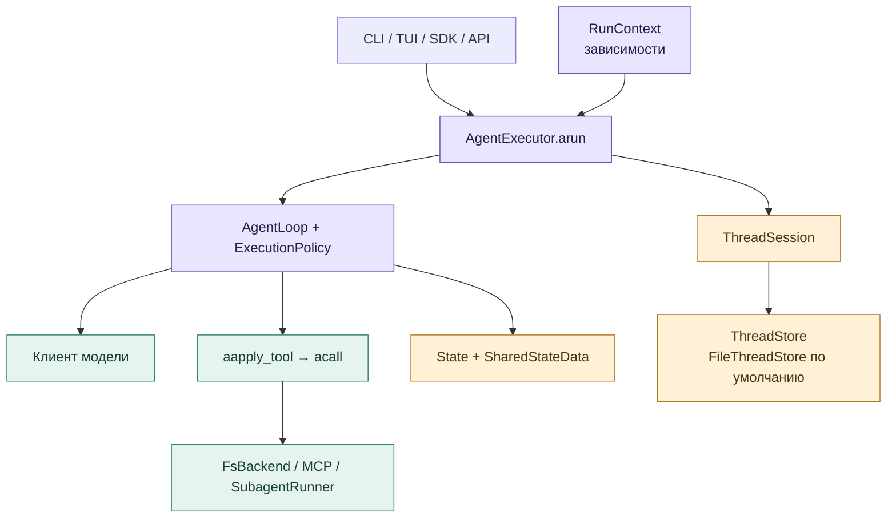
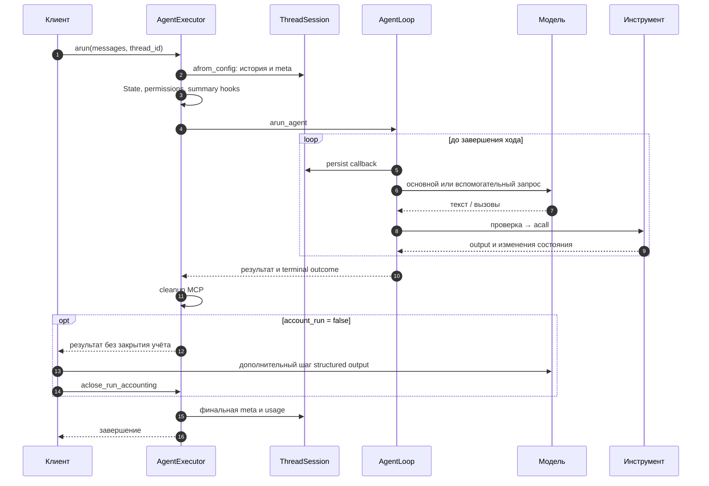
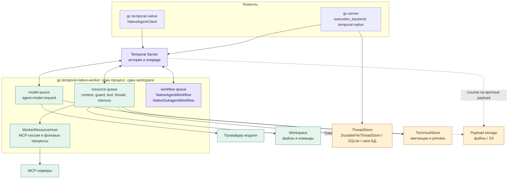
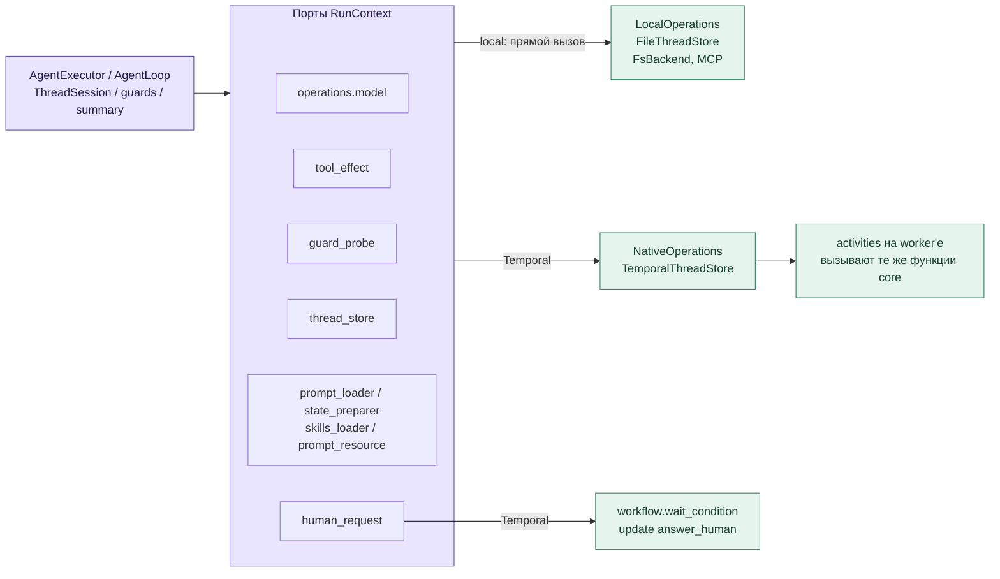
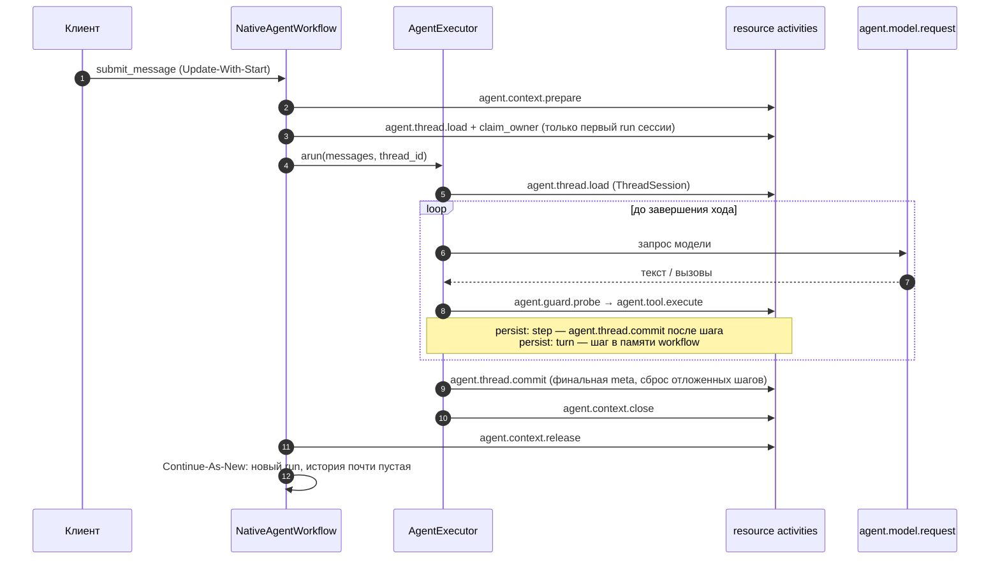
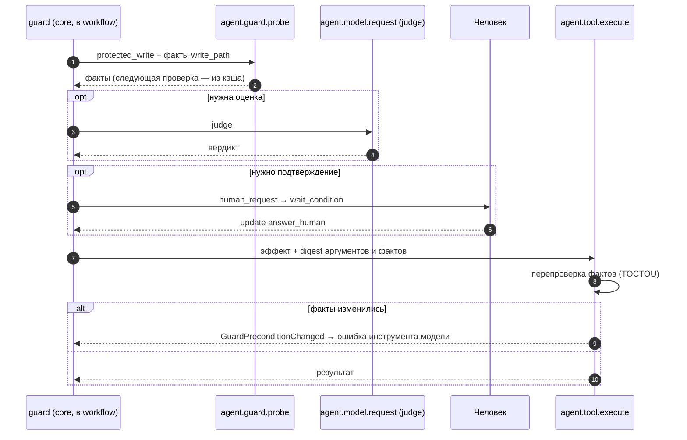
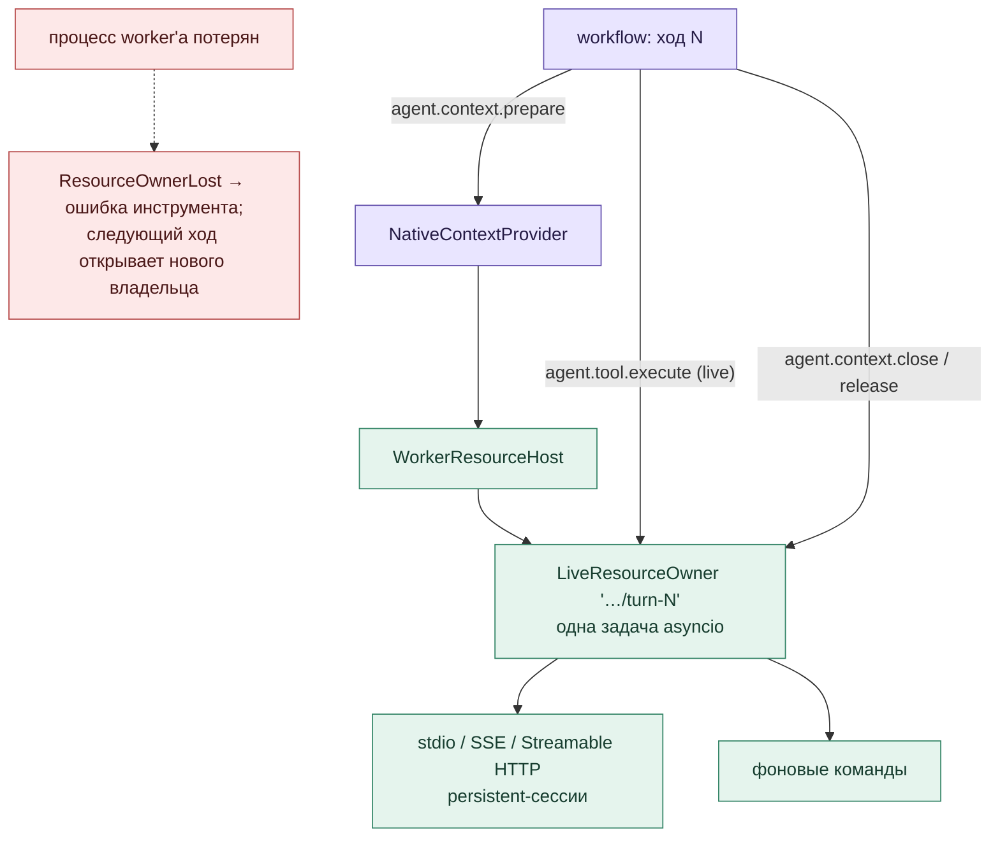
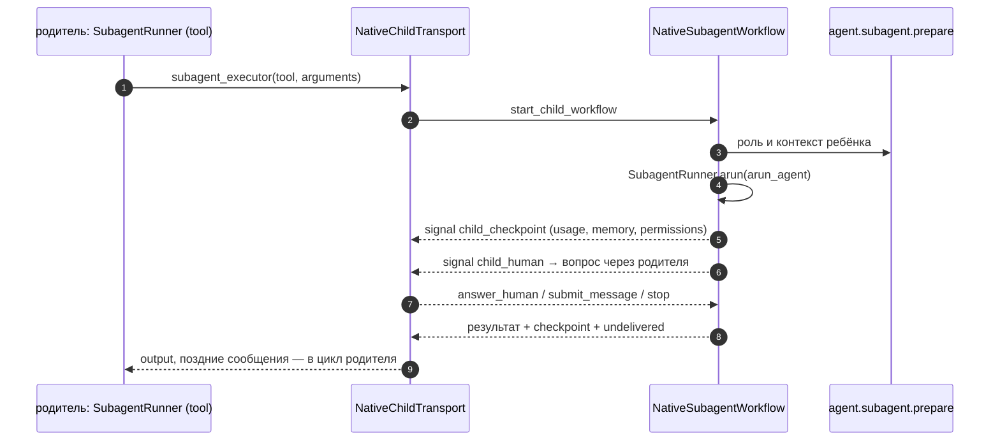
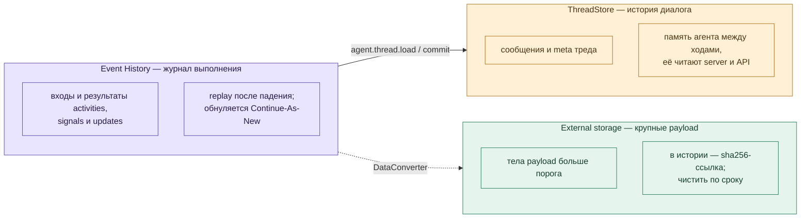

# Universal Agent: нативная интеграция с Temporal

**Статус: реализовано в ветке `feat/temporal-runtime`.** База сравнения — `develop`
`3e7f98e3`. Документ описывает фактические классы, activities и поведение;
итоги проверок — в [разделе 12](#12-проверки).

Основное решение: **один `AgentExecutor`, один `ThreadSession`, один агентский цикл**.
Temporal меняет только исполнителя внешних операций: модель, внешние эффекты
инструментов, I/O хранилища и подготовку контекста. Пакет `gc-ua-temporalio`
связывает штатное ядро с workflow и activities; бизнес-правила остаются в `gc_core`.
Тот же принцип у Pydantic AI (`TemporalDurability`) и у Deep Agents
(`temporalio.contrib.deepagents`).

**Temporal — опциональный backend.** SDK, CLI, server и TUI по умолчанию работают
локально и к Temporal Server не обращаются. TUI и `gc-cli` работают только локально;
Temporal включается worker'ом `gc-temporal-native-worker`, клиентом
`gc-temporal-native` или server backend `execution_backend: temporal-native`.

Схемы для просмотра отдельно и вставки в Outline:

| Схема | PNG | SVG |
|---|---|---|
| Штатный агент: компоненты | [Открыть](diagrams/temporal/00-agent-components.png) | [Открыть](diagrams/temporal/00-agent-components.svg) |
| Штатный агент: один ход | [Открыть](diagrams/temporal/00-agent-turn.png) | [Открыть](diagrams/temporal/00-agent-turn.svg) |
| Процессы и хранилища | [Открыть](diagrams/temporal/01-architecture.png) | [Открыть](diagrams/temporal/01-architecture.svg) |
| Порты операций: local и Temporal | [Открыть](diagrams/temporal/02-dispatch.png) | [Открыть](diagrams/temporal/02-dispatch.svg) |
| Один ход в Temporal | [Открыть](diagrams/temporal/03-turn.png) | [Открыть](diagrams/temporal/03-turn.svg) |
| Guards, подтверждение и эффект | [Открыть](diagrams/temporal/04-guards.png) | [Открыть](diagrams/temporal/04-guards.svg) |
| MCP и фоновые процессы | [Открыть](diagrams/temporal/05-mcp.png) | [Открыть](diagrams/temporal/05-mcp.svg) |
| Субагент в child workflow | [Открыть](diagrams/temporal/06-child.png) | [Открыть](diagrams/temporal/06-child.svg) |
| Три истории: тред, Temporal, payload | [Открыть](diagrams/temporal/07-persistence.png) | [Открыть](diagrams/temporal/07-persistence.svg) |

## 0. Как устроен штатный агент без Temporal

### 0.1. Основные классы

Клиент передаёт сообщения исполнителю. `AgentExecutor` открывает тред, создаёт
состояние хода и запускает общий цикл. Модель предлагает текст или инструменты;
цикл проверяет результат, исполняет действия и передаёт outputs следующему запросу.
«Локальное исполнение» здесь означает процесс цикла: модель, MCP и workspace
могут находиться удалённо.

| Класс / функция | Ответственность и связи |
|---|---|
| [`AsyncAgent`](../packages/core/src/gc_core/aio/agent.py) | SDK-фасад: создаёт контекст и исполнителя, принимает ввод, отдаёт ответ и события. CLI/TUI также используют ядро через свои фасады. |
| [`acreate_run_context`, `RunContext`](../packages/core/src/gc_core/run_context.py) | Подготовка config, logger, tools, router, skills, MCP, `os_backend`, workspace и callbacks. Уже поддерживает внедрение `thread_store`. |
| [`AgentExecutor`](../packages/core/src/gc_core/agent_executor.py) | Жизненный цикл: `_aopen_thread_session`, `_abuild_run_state`, persist/summary hooks, `arun`, teardown, `aclose_run_accounting`. Управление: `add_message`, `stop_run`, `take_undelivered_messages`. |
| [`State`](../packages/core/src/gc_core/states.py), [`SharedStateData`](../packages/core/src/gc_core/execution/state.py) | Messages, usage, счётчики, intent, stop и общие memory/permissions. Новый `State` создаётся на каждый ход; сохраняемые поля восстанавливаются из треда. |
| [`arun_agent`](../packages/core/src/gc_core/processing_responses.py), [`AgentLoop`](../packages/core/src/gc_core/execution/loop.py) | Общий цикл: `_astep`, `_aprepare_batch`, `_adispatch`; pending messages, лимиты, hooks и завершение. |
| [`ExecutionPolicy`](../packages/core/src/gc_core/execution/policy.py) | `aprocess_user_ask`, `aprocess_tool_calls`, `aprocess_tool_outputs`: обработка batches, pairing вызовов и outputs, обратная связь, последовательность инструментов. |

### 0.2. Один штатный ход

Схема показывает путь с подключённым тредом; без `thread_id` его сохранение
отсутствует. Summary и finish judge могут обращаться к модели между основными
шагами. Один проход цикла обрабатывает режим `user_ask`, `function_call`,
`function_call_output` или `text_response`; он не равен всему запросу пользователя.

При обычном `account_run=True` исполнитель закрывает учёт сам. При дополнительном
post-run шаге вызывающий использует `account_run=False`, затем вызывает
`aclose_run_accounting()`. Отмена во время MCP teardown после завершившегося цикла
не должна потерять его итог и usage; cancellation пробрасывается после сохранения.

### 0.3. Модель, инструменты и остальные подсистемы

| Компонент | Что делает сейчас |
|---|---|
| [`ModelRouter.resolve`](../packages/core/src/gc_core/model_router.py) | Выбирает профиль модели для consumer. Основные запросы идут через `processing_responses`; вспомогательные — через [`llm_chat_client`](../packages/core/src/gc_core/utils/llm_chat_client.py). Новый `arequest_chat_completion_outcome` возвращает text и finish reason. |
| [`abuild_tools_data`, `aapply_tool`](../packages/core/src/gc_core/tools/__init__.py) | Готовят каталог и схемы, проверяют аргументы, создают `tool_fabric`, вызывают `acall`. `aapply_tool_result` возвращает output и явные изменения memory/todo; полная изоляция всех остальных инструментов ещё не выполнена. |
| [`FsBackend`](../packages/core/src/gc_core/backends/protocol.py), [`ExecutionWorkspace`](../packages/core/src/gc_core/execution_workspace.py) | Файлы и команды в выбранной среде. Workspace содержит проектные файлы; это отдельное состояние от истории разговора. |
| [`ThreadSession`](../packages/core/src/gc_core/thread_store.py), [`ThreadMetaMapper`](../packages/core/src/gc_core/persistence/thread_meta_mapper.py) | История, meta, известные ключи сообщений, previous response ID и компакция. Mapper переносит shared/state в meta и обратно. |
| [`FileThreadStore`](../packages/core/src/gc_core/thread_store_file.py), [`AsyncThreadStore`](../packages/core/src/gc_core/thread_store_async.py) | Хранение через общий порт. По умолчанию `data_*.jsonl`, `meta_*.json`, trace/служебные файлы; можно внедрить другую реализацию. |
| [`RunSummaryCoordinator`](../packages/core/src/gc_core/run_summary_coordinator.py) | Проверяет pre-run, pre-backend, turn-end и force-компакцию; вызывает модель и сохранение через `ThreadSession`. |
| [`SkillsRegistry`](../packages/core/src/gc_core/tools/skills/registry.py) | Штатные instructions и packs: discovery, источник, namespace, priority skill и содержимое инструкций. |
| [`PermissionStore`](../packages/core/src/gc_core/security/permission_store.py), [`FinishGateGuard`](../packages/core/src/gc_core/intent_guard/guard.py) | Первый хранит решения доступа сессии; второй проверяет достаточность финального ответа. Это разные политики. |
| [`McpClientPort`](../packages/core/src/gc_core/tools/connect_mcp/client_port.py), [`SubagentRunner`](../packages/core/src/gc_core/tools/subagents/runner.py) | MCP discovery/calls и создание дочернего исполнения. У субагента собственные контекст, роль, лимиты и итог; часть shared-данных общая с родителем. |

Очередь поступает через `add_message()`, stop — через `stop_run()`.
Необработанный хвост возвращает `take_undelivered_messages()`. Продолжение треда
в локальном режиме создаёт новый ход на сохранённых данных; файловое хранилище
не сохраняет стек Python, HTTP-запрос или живую MCP-сессию.

## 1. Процессы, очереди и хранилища

| Элемент | Что это |
|---|---|
| [`NativeAgentWorkflow`](../packages/temporalio/src/gc_ua_temporalio/native_workflow.py) | Сессия: очередь сообщений, ответы человека, stop/close, один ход за run. Внутри хода — настоящий `AgentExecutor.arun`. |
| [`NativeSubagentWorkflow`](../packages/temporalio/src/gc_ua_temporalio/native_child_workflow.py) | Субагент: настоящий `SubagentRunner.arun` в child workflow. |
| [`native_worker`](../packages/temporalio/src/gc_ua_temporalio/native_worker.py) | Один процесс обслуживает все три очереди и один workspace; cwd должен совпадать с `profiles.<name>.workspace`. |
| [`NativeContextProvider`](../packages/temporalio/src/gc_ua_temporalio/native_provider.py) | Собирает на worker'е штатный `acreate_run_context` по закреплённому профилю (имя + `revision`). |
| ThreadStore | История диалога. `DurableFileThreadStore`, `SQLiteThreadStore` или своя реализация durable-контракта ([раздел 7](#7-хранение-тред-история-temporal-и-payload)). |
| [`TechnicalStore`](../packages/temporalio/src/gc_ua_temporalio/storage/technical.py) | SQLite worker'а: результаты завершённых activities (повтор не платит второй раз) и необязательные preview. Не хранилище диалога. |
| [Payload storage](../packages/temporalio/src/gc_ua_temporalio/payload_storage.py) | External storage Temporal SDK: payload больше порога (32 КБ по умолчанию) лежат вне истории. |

## 2. Порты операций: один код, два исполнителя

Ядро не импортирует Temporal. Порты заполняет
[`assemble_native_context`](../packages/temporalio/src/gc_ua_temporalio/native_context.py)
через штатный `assemble_run_context`; без портов (локально) ядро вызывает те же
функции напрямую. Чистые инструменты (memory, todo, calculator) исполняются в
workflow и activities не порождают.

### Activities

| Activity | Очередь | Что делает | Повторы |
|---|---|---|---|
| `agent.context.prepare` | resource | Снимок `RunContext`, метаданные инструментов, skills и промпты хода | до 5 |
| `agent.state.prepare` | resource | Подготовка `State` (instructions, workspace data) | до 5 |
| `agent.prompts.prepare` | resource | Промпты, если запрос отличается от предвычисленного | до 5 |
| `agent.prompt.read` | resource | Ленивые промпты (finish gate, summary, judges) | до 5 |
| `agent.skills.list` | resource | Список skills, если не пришёл в prepare | до 5 |
| `agent.model.request` | model | Запрос к модели через общий модельный порт | до 5 |
| `agent.guard.probe` | resource | Факты для guard'а (+ факты следующей проверки того же пути) | до 5 |
| `agent.tool.execute` | resource | Внешний эффект инструмента после повторной проверки фактов | read-only — до 5; эффект — см. [раздел 8](#8-ошибки-повторы-и-неизвестный-исход) |
| `agent.memory.execute`, `agent.memory.hash` | resource | Project memory | эффект / до 5 |
| `agent.summary.trace` | resource | Запись summary trace | до 5 |
| `agent.thread.load`, `agent.thread.commit`, `agent.thread.read_trace` | resource | Чтение и durable-операции ThreadStore | до 5, квитанция по `operation_id` |
| `agent.subagent.prepare` | resource | Подготовка роли и контекста субагента | до 5 |
| `agent.context.close`, `agent.context.release` | resource | Закрытие MCP и освобождение ресурсов хода | до 5 |

Имена закреплены тестом [`test_native_names.py`](../packages/temporalio/tests/test_native_names.py):
это данные совместимости живых сессий. Подписи в Temporal UI безопасны —
без промптов, содержимого файлов и credentials.

## 3. Один ход

Workflow не повторяет логику ядра: подготовку `State`, промпты, summary,
finish gate и учёт делает `AgentExecutor`. Workflow отвечает за доставку
сообщений, ожидания, stop/close и Continue-As-New.

**Continue-As-New после каждого хода.** Новый run получает только состояние
доставки ([`NativeResume`](../packages/temporalio/src/gc_ua_temporalio/native_contracts.py)):
принятые ID сообщений, ответы человека, недоставленные сообщения, эпоху владельца
треда. Диалог уже лежит в ThreadStore, переносить его не нужно. Списки
дедупликации ограничены последними 1000 записями. Простаивающая сессия держит
почти пустую историю, поэтому релиз нового кода её не ломает; ход, идущий в
момент релиза, доигрывается старым кодом — worker нужно останавливать мягко.

## 4. Guards, подтверждение и эффект

Правила guards одни и те же для local и Temporal: генераторы
[`path_policy`](../packages/core/src/gc_core/security/path_policy.py),
[`read_guard`](../packages/core/src/gc_core/security/read_guard.py),
[`command_moderation`](../packages/core/src/gc_core/security/command_moderation.py)
выполняются в workflow, а факты о файловой системе приносит
[`evaluate_guard_probe`](../packages/core/src/gc_core/security/guard_probe.py).
Probe вызывается только для файловых и командных инструментов и только для
включённых проверок; защищённые пути (`protected_paths`) включены по умолчанию.
Ожидание человека не занимает worker: это `workflow.wait_condition`.

## 5. MCP и фоновые процессы

Владелец живых ресурсов — один на ход, как `begin/end run` в local:
[`WorkerResourceHost`](../packages/core/src/gc_core/execution/resource_host.py).
Discovery, вызовы и teardown MCP идут в одной задаче, повторная доставка той же
операции ждёт тот же результат. Ошибка вызова MCP — ошибка инструмента, сессия
остаётся живой; закрывается владелец только при потере транспорта
(`McpSessionLostError`). Ресурсы не переживают процесс: после перезапуска
worker'а модель получает `ResourceOwnerLost` и может продолжить; внутреннее
состояние MCP-сервера не восстанавливается. Фоновый владелец создаётся лениво.

## 6. Субагент в child workflow

Одновременно активен один ребёнок, как в local. Сигнал ребёнка, пришедший раньше
handle, ждёт его, а сигнал неактивного ребёнка игнорируется и родителя не роняет.
Сообщение, пришедшее после конца цикла ребёнка, возвращается родителю.

## 7. Хранение: тред, история Temporal и payload

| Слой | Что хранит | Сколько живёт |
|---|---|---|
| ThreadStore | История диалога — источник правды | Постоянно |
| Event History | Журнал выполнения одного run | Пока run открыт + retention namespace |
| External storage | Крупные payload этого журнала | Нужно чистить: lifecycle S3 или `prune_file_payloads` |

**Durable-контракт хранилища.** Повтор activity может прийти дважды, поэтому
хранилище в Temporal реализует два метода поверх обычного `ThreadStore`:
`read_snapshot` (meta, сообщения, `revision`, `generation`, владелец) и
`commit_operation` (атомарная операция с `operation_id`, `expected_revision`,
владельцем). Повтор той же операции возвращает исходную квитанцию; дедупликацию
сообщений хранилище делает само, `expected_revision` гарантирует согласие с сессией.
Свою реализацию (Postgres, S3) проверяют одной строкой:
`assert_durable_conforms(factory)` из
[`gc_testkit.durable_thread_store_conformance`](../packages/testkit/src/gc_testkit/durable_thread_store_conformance.py).

| Хранилище | Где | Как устроено |
|---|---|---|
| [`FileThreadStore`](../packages/core/src/gc_core/thread_store_file.py) | local по умолчанию | Как в develop: `data_*.jsonl`, `meta_*.json`, без журнала. В тред, которым владеет Temporal, не пишет. |
| [`DurableFileThreadStore`](../packages/core/src/gc_core/thread_store_file_durable.py) | Temporal, один хост | Те же файлы + `.store/`: квитанции, журнал прерванной записи, владелец. |
| [`SQLiteThreadStore`](../packages/temporalio/src/gc_ua_temporalio/storage/sqlite.py) | Temporal | Транзакции SQLite. |

**Когда писать тред** — `thread_store.persist` в профиле:

| Значение | Когда пишем | По умолчанию |
|---|---|---|
| `step` | После каждого шага и в конце хода | local (единственное допустимое) |
| `turn` | В точках сброса: конец хода, перед компакцией, перед ожиданием человека (кроме вопроса субагента — тред родителя пишется в конце его хода), при stop/ошибке | Temporal |

В режиме `turn` шаги до сброса защищены историей workflow: после падения worker'а
replay восстанавливает буфер. Шаги теряются из треда, только если workflow
принудительно завершить (`terminate`) до сброса. Local без durable-исполнителя
`turn` отклоняет.

## 8. Ошибки, повторы и неизвестный исход

Семантика как у Pydantic AI и как в local: ход продолжается, если модель может
отреагировать на ошибку.

| Ситуация | Что видит модель / workflow |
|---|---|
| Доменная ошибка в activity (`ValueError`, `OSError`, …) | Переносится значением (`DomainError`) и поднимается в workflow тем же типом — ядро возвращает модели `internal_tool_error`, как в local |
| Факты guard'а изменились до эффекта | `GuardPreconditionChanged` — ошибка инструмента, эффект не исполнен |
| Запрос к модели упал вместе с worker'ом | Temporal повторяет; если ответ пришёл, а квитанция нет — повторная оплата одного запроса |
| Read-only инструмент, подготовка, хранилище | Повтор Temporal (до 5) |
| Эффект инструмента (запись, команда, MCP, project memory) | Вторая попытка только читает квитанцию первой и **никогда не исполняет эффект заново**; квитанции нет — модель получает «исход неизвестен, проверьте состояние» (`ToolOutcomeUnknown`) |
| Потеря MCP или фонового владельца | `ResourceOwnerLost` — ошибка инструмента |
| Хранилище треда недоступно, подготовка контекста, исчерпаны повторы модели | `InfrastructureFailure` — ход завершается ошибкой |

Операторского восстановления нет: решение после неизвестного исхода принимает
модель, как после падения процесса в local. Exactly-once внешних эффектов не
обещается.

## 9. Сервер и клиент

`execution_backend: temporal-native` монтирует HTTP API
[`http_api`](../packages/temporalio/src/gc_ua_temporalio/http_api.py) и
переводит `/events/webhook`, `/runs`, `/logs` на Temporal. Сообщение отправляется
через **Update-With-Start**: одна атомарная операция «доставить, при необходимости
открыв сессию». Закрытая или упавшая сессия с тем же ID начинается новым run и
продолжает тот же тред. Статусы: `idle`/`completed` → `completed`,
`stopped` → `cancelled`, `failed` → `failed`.

Команды клиента: `gc-temporal-native start | status | result | stop | answer | close | send`;
`--config` нужен, если включён `payload_storage`.

## 10. Конфигурация

[Native quickstart и настройки](temporal-configuration.md#native-quickstart),
[размещение worker'а](temporal-native.md), пример
[`native-worker.json`](../packages/temporalio/examples/native-worker.json).

## 11. Ограничения

- Один процесс worker'а обслуживает все очереди и один workspace; раздельное
  развёртывание model/resource не поддержано этим entrypoint.
- MCP-сессии и фоновые процессы не переживают процесс worker'а.
- Внешний эффект — не более одного исполнения; после падения в середине исход
  может быть неизвестен, и модель должна проверить состояние сама.
- Запрос к модели может быть оплачен дважды при падении после ответа.
- Worker Versioning не используется: ход, идущий в момент несовместимого релиза,
  нужно доиграть старым кодом (мягкая остановка worker'а).
- Blob'ы external storage Temporal не удаляет — нужна очистка по сроку.
- Одновременно активен один субагент.
- Workflow histories прежнего экспериментального протокола не поддерживаются и
  не мигрируются; этот протокол удалён.

## 12. Проверки

Полные прогоны 02.10.2026 на итоговом коде ветки:

| Набор | Результат |
|---|---|
| `tests` + mcp + core + cli + server | 7309 passed, 4 skipped |
| `packages/temporalio/tests` (включая live с Temporal dev server) | 203 passed |
| `packages/tui/tests` | 4144 passed, 1 skipped, 9 xfailed |
| Ruff check / format | без замечаний |

Что покрыто:

- **Local = develop**: 44 эталонные трассы develop `3e7f98e3` совпадают; локальный
  `FileThreadStore` не создаёт `.store/`; архитектурный тест пар sync/async зелёный.
- **Durable-контракт**: `assert_durable_conforms` проходят `DurableFileThreadStore` и
  `SQLiteThreadStore`; внешнее удаление файлов треда не ломает следующую запись.
- **Падения** (SIGKILL worker'а, File и SQLite): до и после commit хранилища, до и после
  квитанции модели, до запроса и после ответа модели — ход завершается, история без
  дублей, replay без новых вызовов; повторная оплата модели — только в окне «ответ
  получен, квитанции нет». Для `persist: turn` — падения до и после финального commit.
- **Живые ресурсы**: после SIGKILL первый эффект возвращается из квитанции, повторно
  не исполняется; MCP-вызов после потери владельца — ошибка инструмента; отмена во
  время teardown MCP.
- **Субагенты**: модель, инструменты, ввод, вопрос человеку, stop, fallback, replay.
- **External storage**: вход activity 200 КБ хранится по ссылке, история без тела.
- **Activities** на контролируемом сценарии (2 запроса модели, 1 инструмент):
  было 26 / 24, сейчас 23 / 21 при `persist: step` и **14** при `persist: turn`;
  событий истории 161 → 89.

Живая серия качества на реальной модели в этом прогоне не повторялась.
