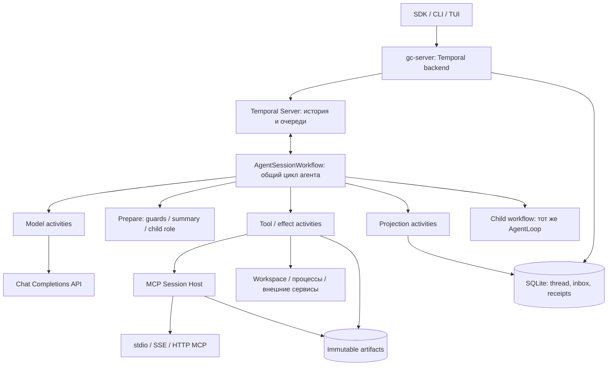

# Temporal runtime

`gc-ua-temporalio` — opt-in исполнение Universal Agent через Temporal. Локальный
runtime остаётся режимом по умолчанию. Интеграция использует общий `AgentLoop`
и политики `gc-core`; Pydantic AI не является её зависимостью.

Подробные схемы процессов, вызовов и справочник классов/функций:
[целевая архитектура после нативного переезда](temporal-architecture.md),
[проект для просмотра в браузере](temporal-architecture.html).
Эти схемы описывают планируемую архитектуру, которая ещё не реализована.
Команды и описание runtime ниже относятся к текущему экспериментальному варианту.

## Что где живёт



Workflow содержит сериализуемое состояние и решения о порядке действий.
Activity читает файлы, обращается к модели или исполняет инструмент. Temporal
сохраняет результаты завершённых activities; при replay они не исполняются снова.
SQLite хранит проекцию `ThreadSession` для приложений, журнал сообщений и
операций. Artifacts содержат большие результаты и checkpoints. `FsBackend`
остаётся ресурсом исполнителя, а не вторым хранилищем состояния workflow.

Идентичность сессии: namespace + Workflow ID. SDK использует
`ua:<длина system>:<system>:<thread>`, без неоднозначного склеивания имён.
Activity получает владельца сессии и operation ID. Общая task queue распределяет
задачи между совместимыми workers; она не смешивает контекст разных workflow.
Workspace выбирается профилем. Изоляция каталогов требует разных workspace.

## Быстрый запуск

Из корня репозитория:

```bash
uv sync --all-packages
temporal server start-dev --ip 127.0.0.1 --ui-ip 127.0.0.1 --db-filename /absolute/path/temporal.db
```

UI — <http://localhost:8233>, gRPC — `localhost:7233`. Уже работающий сервер
можно использовать повторно. Конфигурация worker и примеры MCP/server находятся
в [настройках Temporal](temporal-configuration.md).

```bash
uv run gc-temporal-worker --config /absolute/path/runtime.json
uv run gc-temporal start --thread demo-001 --prompt 'Прочитай example.txt и закончи через turn_finish.'
uv run gc-temporal status 'ua:8:temporal:demo-001'
uv run gc-temporal send 'ua:8:temporal:demo-001' --message-id message-2 --text 'Запомни результат.'
uv run gc-temporal close 'ua:8:temporal:demo-001'
uv run gc-temporal result 'ua:8:temporal:demo-001'
```

`phase=idle` означает, что ответ готов и сессия ждёт следующего сообщения.
В Temporal UI такая сессия имеет статус **Running**. `close` завершает сессию
после принятой работы, `stop` останавливает текущий ход. Закрытие окна CLI/TUI
или HTTP-соединения не останавливает workflow. Для одного задания есть
`start --auto-close`. Закрытый thread не открывается заново: создайте новый ID.

В Temporal UI выберите тип `AgentSessionWorkflow`, queue `ua-workflow`, задайте
уникальный Workflow ID и один JSON input:

```json
{
  "thread_id": "ui-demo-001",
  "prompt": "Прочитай example.txt и сообщи результат.",
  "profile": "demo",
  "profile_revision": "v1",
  "resource_queue": "ua-resource-local",
  "model_queue": "ua-model"
}
```

Состояние доступно через Query `status`. Signal `close_session` не требует
аргумента. Если UI не умеет отправлять Updates, используйте SDK или CLI.
Ключ модели в workflow input не передаётся.

## Подтверждения, stop и неизвестный исход

`turn_ask_human` и guard approval создают ожидание в workflow. Activity не держит
stdin или callback до ответа человека. `status.pending_human` содержит вопрос
и `request_id`; ответ имеет собственный стабильный `reply_id`:

```bash
uv run gc-temporal answer WORKFLOW_ID --request-id REQUEST_ID --reply-id reply-1 --answer allow_once
uv run gc-temporal stop WORKFLOW_ID --turn-id TURN_ID
```

Для обычного вопроса `--answer` содержит текст, для подтверждения — `allow_once`
или `deny_once`. Повтор ID с тем же содержимым идемпотентен. Старое подтверждение
не разрешает изменённые аргументы или изменённый файл: требуется новое решение.

FS write/append/edit/base64/download сначала проходят исходные guards и готовят
bytes. Перед записью проверяются исходные факты файла; публикация атомарна.
Родительский каталог должен существовать; `make_dirs` и `backup` должны быть
выключены. Symlink/hardlink цели не поддерживаются. Внешние редакторы не участвуют
в workspace lock; конкурентное изменение файла требует отдельной координации.

Команды и Python проходят исходный command judge отдельными model activities.
Поддержано выполнение на переднем плане с timeout не более 180 секунд.
Повтор после неизвестного исхода запрещён: activity эффекта имеет одну попытку.
`STARTED`/`UNKNOWN` удерживает fence всего workspace до reconciliation.

Для файла можно проверить фактические bytes. Произвольную команду или MCP
нельзя объявлять неисполненной только из-за timeout. После проверки эффекта
и остановки всех прежних исполнителей оператор явно фиксирует результат:

```bash
uv run gc-temporal reconcile WORKFLOW_ID --operation-id OPERATION_ID --request-id check-1
uv run gc-temporal reconcile WORKFLOW_ID --operation-id OPERATION_ID --request-id resolution-1 --resolution applied --processes-stopped --output 'Проверенный результат операции'
```

`applied` и `not_applied` требуют описания проверенного результата и подтверждения
остановки процессов. Эти команды записывают исход и не исполняют эффект повторно.
`stop` также не обходит неразрешённый UNKNOWN.

Завершённый вызов модели не повторяется. Между внешним ответом и записью receipt
остаётся окно неопределённости: при падении запрос может повториться и повторно
расходовать токены. Гарантия exactly-once для произвольных внешних API не заявляется.

## Сессии, память и компакция

Сообщение поступает через Update `submit_message` с `message_id` и `text`.
Receipt хранит `ACCEPTED`, затем `PROCESSED`, `STOPPED`, `DROPPED_BY_STOP` либо
`FAILED`. Повтор с изменённым текстом отклоняется. Поздний ввод забирается общим
циклом через pending/tail. Ошибка хода не стирает принятые сообщения; дальнейший
ввод может начать новый ход в той же сессии.

`session_memory` и `session_todo` возвращают явные изменения состояния. Общий
`RunSummaryCoordinator` сохраняет логику порогов, anchors и сохранённого хвоста:
prepare → отдельные LLM activities → применение patch → archive/projection.
`session_compact` использует тот же координатор. Проекция содержит полную историю,
а рабочий контекст после компакции сокращён.

Continue-As-New выполняется на границе ходов, после завершения обработчиков:
по умолчанию через 20 ходов, по рекомендации сервера или после 6000 событий.
Переносятся owner, счётчики, память, mailbox и snapshot. При активном ребёнке
или ожидании подтверждения перехода нет. Один длинный ход ограничивается
профилем, а не разрывается посередине tool batch.

## Persistent MCP и субагенты

MCP Session Host запускается **отдельным процессом** и владеет соединениями
существующих MCP clients. Activity отправляет вызов и ждёт receipt. Падение
activity worker не закрывает MCP-сессию. Повтор operation ID получает сохранённый
результат; большие/binary ответы сохраняются в artifacts.

Поддерживаются stdio, persistent stdio, SSE и streamable HTTP, включая варианты
`stream_*`. Сохраняются настройки TLS/custom CA/mTLS и `execute_on` исходного
client port. Один host обслуживает несколько изолированных owner/generation.
Lease supervisor проверяет закрытие workflow перед очисткой ресурсов;
недоступность Temporal Server не считается разрешением уничтожить сессию.

При гибели host или прикладной MCP-сессии возвращается `SESSION_LOST`, либо
UNKNOWN для начатого эффекта. Пустая сессия не подставляется незаметно. Для
продолжения проверьте старый эффект, закройте/остановите прежнюю сессию и явно
создайте новую. Сохранённые receipts доступны и после потери соединения.

Настроенные встроенные субагенты запускаются последовательно как child workflow.
Они используют общий цикл, исходные роли/схемы/assignment и ограниченный бюджет
родителя. Память, usage, tool count и trace возвращаются явно и применяются один
раз. SDK направляет ввод и ответы активному ребёнку; stop родителя передаётся
ребёнку. Parent Close Policy — `ABANDON`: аварийное завершение родителя не
уничтожает ребёнка с неразрешённым эффектом. Такой ребёнок виден в `child_runs`
и требует явного управления оператором. Обычное завершение родителя ждёт ребёнка.

## Приложения

После включения server backend:

```bash
uv run gc-cli --temporal-url http://localhost:8000 --thread demo-remote --message-id request-1 --message 'Прочитай example.txt' --watch
uv run gc-ua --temporal-url http://localhost:8000 --thread demo-remote
```

Токен REST-сервера читается из `GC_REMOTE_TOKEN`. Remote TUI имеет отдельный
provider статуса, истории и событий; локальные diff-journal и файловые locks
не используются. Поддержаны сообщения, ответы, `/allow`, `/deny`, `/stop`,
`/close`; Ctrl+Q отключает интерфейс. Остальные локальные команды TUI сюда
автоматически не переносятся.

Preview stream содержит operation/attempt/sequence. Новый attempt заменяет
предыдущий preview; committed result имеет приоритет. Cursor и номера сообщений
защищают от повторного вывода при reconnect. SSE endpoint поддерживает
`Last-Event-ID`. Preview — промежуточный текст, не подтверждение побочного эффекта.
UI может менять только `title`, `pinned`, `archived` в отдельной таблице.

Progress notifications MCP по SSE/Streamable HTTP и `stream_stdio` попадают
в тот же preview stream. Host маркирует их operation/attempt/sequence, а receipt
закрывает preview; reconnect activity worker не создаёт второй вызов инструмента.
Обычный persistent `stdio` передаёт итоговый результат без progress notifications.

## Пределы первой версии

- Один resource host, общие SQLite/artifacts/workspace для его workers и API.
  Каталог не переносится между машинами автоматически. SQLite WAL размещайте
  на локальной файловой системе, не на сетевой шаре.
- Chat Completions. Responses API, динамический model routing/fallback и
  произвольные core hooks требуют отдельного адаптера; неизвестные поля
  конфигурации отклоняются.
- Конечный список tools приведён в настройках. Неподдержанный tool не получает
  неявного локального исполнения.
- Один уровень последовательных встроенных субагентов. Нет параллельного merge,
  файловых custom-subagent definitions и многоуровневого дерева.
- Нет восстановления уничтоженного stateful MCP приложения, multi-host workspace
  failover, фоновых shell-процессов, MCP sampling/elicitation.
- Команда/результат activity — до 512000 байт; большие outputs выносятся в
  artifacts. Порог компакции не отменяет hard limit сериализованного состояния.
  Очень большие memory, schema или единичное сообщение отклоняются.
- До 64 сообщений в mailbox, до 16000 символов текста и до 128 символов ID.
  По умолчанию 20 шагов/200 tools/200000 токенов на ход; tool batch дожимается
  по политике core. `exec_sleep` остаётся activity и может начать ожидание заново
  после падения. Модель/read activities — до трёх попыток, heartbeat 2/10 секунд.

## Эксплуатация и обновление

SDK Temporal закреплён на `1.33.0`, MCP SDK — на версии core (`1.26.0`). DTO
имеют `schema_version=1`. Изменения workflow помечены `ua-controls-v1`,
`ua-session-v2`, `ua-compaction-v1`; удалять старые ветви до закрытия старых
histories нельзя. Revision профиля закрепляется digest в SQLite; смена настроек
под тем же revision останавливает новый worker. Ротация значения credential
в окружении не меняет revision.

1. Перед обновлением сохраните histories характерных активных/завершённых runs
   и проверьте offline replay новым кодом.
2. Если replay несовместим, оставьте старый worker с прежним кодом/профилем и
   прежними queues; новые сессии направляйте в новые queues. Новый revision
   сам по себе не маршрутизирует задачи к правильному worker.
3. Не удаляйте SQLite receipts, artifacts или историю Temporal активной сессии.
   Срок хранения этих данных должен покрывать срок жизни сессии и расследования.
   Автоматический retention/GC artifacts этой версией не выполняется.
4. Для согласованного backup остановите приём новых сессий, дождитесь/разрешите
   эффекты, затем снимите backup SQLite и artifacts вместе с Temporal persistence.
   Копия одного `.sqlite` во время записи без WAL/backup API недостаточна.
5. После restore верните те же queues, profiles и workspace. Не открывайте
   temporal-owned thread локальным writer. MCP host loss остаётся SESSION_LOST,
   даже если база восстановлена.

`GET /temporal/{system}/{thread}/metrics` показывает attempts активных activities,
счётчики STARTED/UNKNOWN/SESSION_LOST и отставание projection. Следите также за
schedule-to-start latency, activity failures/retries и размером history в Temporal.
Длительный `needs_reconciliation`, отсутствие poller или рост projection lag
требуют проверки worker и storage; автоматический retry эффекта не является ремонтом.

## Проверки

`packages/temporalio/tests/` содержит unit/contract и реальные subprocess tests:
SIGKILL между model/tool/эффектом/projection, approval restart, stop, pending input,
compaction, Continue-As-New, MCP transports/host loss, child recovery и reconnect API.
Replay выполняется в стандартном sandbox без внешнего I/O. Реальные проверки
требуют установленный Temporal CLI. Локальные core/app regression tests запускаются
отдельно; вывод тестов и подробности приёмки не включаются в продуктовые данные.

```bash
uv run pytest packages/temporalio/tests -q
uv run pytest packages/core/tests packages/server/tests packages/cli/tests packages/tui/tests tests -q
scripts/lint.sh
```

Базовые механизмы SDK: [сообщения workflow](https://docs.temporal.io/develop/python/workflows/message-passing),
[Continue-As-New](https://docs.temporal.io/develop/python/workflows/continue-as-new).
