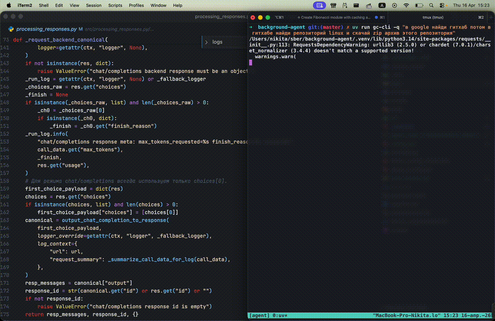

# GigaCode CLI (gc-cli)

Background и CLI-клиент для работы с агентом GigaCode: отправка запросов, вызов инструментов и MCP-серверов. Требуется запущенный бэкенд агента с API `v1/responses` или режимом `chat_completions` с доступом к модели (chat/completions - openrouter, vllm и др.).

**Требования:** Python 3.10 или новее.

---

# Установка в режиме разработки  

1. **Установка с помощью uv (рекомендуется).** В корне проекта выполните:

    ```bash
    uv sync          # установка зависимостей
    uv tool install -e .   # установка gc-cli как инструмента
    ```

    После этого можно переходить к шагу 3.

2. **Классический путь через pip.** В корне проекта выполните:

    ```bash
    pip install -e .
    ```

    Для установки в конкретный интерпретатор Python (например 3.12):

    ```bash
    python3.12 -m pip install -e .
    ```

    Если при установке возникает ошибка, связанная с `distutils`, обновите pip:

    ```bash
    python3.12 -m ensurepip --upgrade
    ```

3. **Использование клиента**

    После установки команду `gc-cli` можно вызывать из любой папки, например:

    ```commandline
    gc-cli -q "создай подпапку test_project. В ней напиши на Python модуль
    вычисления чисел Фибоначчи. В отдельном файле напиши тесты. Прогони тесты,
    посчитай первые 1000 чисел Фибоначчи и сохрани результат в JSON там же.
    Пиши быстрый код с кешированием. Скажи, чему равно 1000-е число Фибоначчи,
    умноженное на 3."
    ```
   
4. **Конфигурация клиента**

    - Требуется запущенный GigaCode Agent с API `v1/responses` или с режимом `backend_api_mode: chat_completions`. Адрес сервиса задаётся в `config.yml`.
    - **Где ищется конфиг:** по умолчанию — файл `config.yml` рядом с установленным пакетом (каталог, откуда был выполнен `pip install -e .`, подкаталог `src`). Чтобы использовать конфиг из текущей папки или указать свой путь:
      ```commandline
      gc-cli -q "ваш вопрос" --config ./config.yml
      ```
    - Пример конфигурации: `demo_config.yml`. Скопируйте в `config.yml` и отредактируйте под свой бэкенд и MCP-серверы.
    - В конфиге можно задать количество шагов агента (`max_steps`), логирование и другие параметры.
    - Для режима `backend_api_mode: chat_completions` можно передавать токен провайдера
      (например OpenRouter) через `chat_completions_auth_token` (или алиас `openrouter_api_key`);
      тогда клиент отправит `Authorization: Bearer <token>` в запрос к `completions_url`.
      Опционально для OpenRouter поддерживаются заголовки `openrouter_http_referer`
      и `openrouter_x_title` (в запросе это `HTTP-Referer` и `X-OpenRouter-Title`).
    - Для хранения истории тредов:
      - по умолчанию используется папка `threads` в корне проекта (`mini-cli-pub/threads`);
      - опциональный параметр `threads_data_path` в `config.yml` должен быть **абсолютным путём** к директории хранения;
      - параметры суммаризации в `chat_completions` задаются в секции `summary_params`:
        - `summary_params.chat_completions_summary_trigger_chars`:
          - `<= 0` (или отсутствует) — суммаризация выключена;
          - `> 0` — при достижении/превышении порога тред архивируется (`data_*`/`meta_*` с суффиксом `__summarized_<YYYYMMDD_HHMMSS>`) и продолжается от compact summary;
        - `summary_params.incremental_batch_chars` — размер батча для кумулятивной суммаризации; если не задан, используется `int(summary_params.chat_completions_summary_trigger_chars * 1.4)`;
        - `summary_params.chat_completions_summary_prompt_path` (опционально), по умолчанию `prompts/chat_completions_summary_prompt.md`;
        - `summary_params.max_message_chars` — максимум символов на одно сообщение при подготовке истории к суммаризации (по умолчанию `50000`);
        - `summary_params.max_dialogue_chars` — максимум символов на весь диалог для суммаризации (по умолчанию `1000000`, берется хвост целыми сообщениями);
        - `summary_params.max_accumulated_summary_chars` — лимит длины накопленного summary; при превышении запускается дополнительное сжатие summary-of-summary (по умолчанию `20000`);
        - `summary_params.original_user_messages_max_chars` — лимит символов для `meta.user_messages_log` (единственный источник user-запросов для суммаризации); сохраняются последние сообщения целиком (по умолчанию `20000`);
        - `summary_params.last_dialog_steps_count` — сколько последних сообщений включать;
        - `summary_params.last_dialog_step_message_max_chars` — максимум символов на одно сообщение (лишнее обрезается).
      - **Поток суммаризации** (только при `backend_api_mode: chat_completions` и положительном `summary_params.chat_completions_summary_trigger_chars`):
        - перед стартом цикла агента выполняется **pre-run** compaction (если объём диалога в `state.messages` уже достиг порога);
        - после шага с исходящим результатом инструмента (**post-step**, сразу после обработки `function_call_output`) снова проверяется порог и при необходимости запускается compaction;
        - источник данных для решения «суммаризировать или нет» — только текущие сообщения сессии (`state.messages`); при запуске с `-t` после успешного compaction дополнительно обновляются файлы треда через `thread_store` (архив старых `data_*/meta_*` и запись compact-истории).
      - `gc-cli -q "..." -t my-thread` — продолжить диалог по треду;
      - `gc-cli -q "..." -t my-thread -n` (или `--new`) — начать тред заново с тем же id и удалить старые файлы этого треда (`data_*`/`meta_*`);
      - `-n/--new` можно использовать только вместе с `-t/--thread-id`.
      - в директории для тредов создаются файлы `data_<thread_id>.jsonl` (сообщения) и `meta_<thread_id>.json` (метаданные, включая `previous_response_id`).
    - По умолчанию логи будут сохраняться в той папке, из которой запущена команда.

5. **Переопределение настроек config.yml из CLI**

    Любой параметр из `config.yml` (или новый, которого там нет) можно переопределить при запуске через дополнительные аргументы командной строки.

    - Значения из CLI **всегда имеют приоритет** над значениями из `config.yml`.
    - Поддерживаются следующие формы:
      - `--param value`
      - `--param=value`
      - `--flag` (без значения, в конфиг уйдёт `true`)
    - Значения автоматически приводятся к типам с помощью `yaml.safe_load`, поэтому:
      - `--max_steps 50` → `config_dict["max_steps"] == 50` (число),
      - `--verbose true` → `config_dict["verbose"] == True` (булево),
      - `--client_name "my_client"` → `config_dict["client_name"] == "my_client"` (строка).

    **Примеры:**

    - Переопределить существующие ключи:
      ```bash
      gc-cli -q "..." --agent_md_path "my path" --max_steps 50
      ```
      В рантайме будет использовано:
      - `config_dict["agent_md_path"] == "my path"`,
      - `config_dict["max_steps"] == 50`,
      даже если в `config.yml` заданы другие значения.

    - Добавить новый параметр, которого нет в `config.yml`:
      ```bash
      gc-cli -q "..." --my_custom_flag true --extra_param "some value"
      ```
      В `config_dict` появятся:
      - `config_dict["my_custom_flag"] == True`,
      - `config_dict["extra_param"] == "some value"`.


6. **MCP-серверы**

   Клиент поддерживает MCP (Model Context Protocol): агент может вызывать инструменты
   внешних MCP-серверов (поиск, RAG, файловая система, выполнение кода и т.д.).

   Настройка — в `config.yml`, секция `mcp-servers`. Каждый сервер задаётся ключом-именем
   (например `rag`, `search`, `python`); этот ключ служит префиксом имён инструментов
   (например `search_web_search`). Используйте короткие имена из латинских букв, цифр и символов `-_`, без пробелов.

   Поддерживаются шесть типов транспорта MCP:

   **Сессионные транспорты** (один запрос — один ответ, при необходимости используется `mcp-session-id`):

   - **http** — запросы по HTTP. Обязательно: `transport: http`, `url`, `description`, `server-name`. Опционально: `token`, `verify-ssl`.
   - **sse** — обмен через Server-Sent Events. Обязательно: `transport: sse`, `url`, `description`, `server-name`. Опционально: `token`, `verify-ssl`.
   - **stdio** — MCP-сервер как локальный процесс (stdin/stdout); процесс запускается на каждый запрос. Обязательно: `transport: stdio`, `command`, `description`, `server-name`. Опционально: `args`, `cwd`, `env`.

   **Стриминговые транспорты** (через MCP SDK, без сессий; подходят для серверов, поддерживающих streamable-протокол):

   - **stream_http** — Streamable HTTP (MCP 1.26+). Обязательно: `transport: stream_http`, `url`, `description`, `server-name`. Опционально: `token`, `verify-ssl`. Endpoint обычно `.../mcp`; при 404 пробуется базовый URL.
   - **stream_sse** — SSE в формате MCP SDK. Обязательно: `transport: stream_sse`, `url`, `description`, `server-name`. Опционально: `token`, `verify-ssl`.
   - **stream_stdio** — stdio через MCP SDK (процесс на каждый запрос). Обязательно: `transport: stream_stdio`, `command`, `description`, `server-name`. Опционально: `args`, `cwd`, `env`.

   **Общие параметры:** для любого транспорта можно задать `verify-ssl: true` (по умолчанию) или `verify-ssl: false` (отключить проверку SSL, например для self-signed сертификатов).

   **Кроссплатформенность (stdio / stream_stdio):** в `command` и `args` указывайте команду, доступную в PATH на вашей ОС (например, на Windows — `python` или `py`, а не только `python3`). Пути к скриптам в `args` лучше задавать в формате, принятом на целевой ОС, или использовать переменные окружения в `env`.

   В секции `mcp-meta` можно задать:
   - `tools-cache-ttl` — время жизни кэша списка инструментов (секунды);
   - `request_timeout_sec` — таймаут запроса к MCP (секунды).

   Полные примеры для http, sse, stdio и комментарии по stream_http/stream_sse/stream_stdio — в `demo_config.yml`. Скопируйте нужный блок, подставьте свои `url` или `command`/`args`.

7. Конкретные полезные MCP серверы

  - поиск DDGS-MCP
  Установите и запустите в отдельном процессе mcp сервер поиска. В конфиге агента проверьте, что mcp сервер указан с нужным транспортом и ендпоинтом подключения
  ```
  python3 -m pip install ddgs-mcp
  ddgs-mcp --http
  ```

8. **Пакет рекомендованных MCP (`recommended_mcp/`)**

   В папке `recommended_mcp/` лежит готовый установщик для набора MCP-серверов,
   которые часто нужны агенту: `office-reader` (чтение pdf/docx/xlsx/...),
   `browser_playwright` (управление браузером через Playwright), `computer`
   (Windows-only GUI control через UI Automation).

   Манифест установки — `recommended_mcp/config.yml`. Чтобы пропустить
   конкретный MCP, закомментируй его блок там перед запуском `install.py`.

   ### Установка

   Из корня проекта:

   ```bash
   python recommended_mcp/install.py
   # или
   uv run python recommended_mcp/install.py
   ```

   Что произойдёт:

   - **office-reader** — `pip install` из приложенного wheel-файла
     (`recommended_mcp/office-reader/dist/*.whl`). Появится консольная команда
     `mcp-office-reader`.
   - **browser_playwright** — скачает и распакует пиннутый Node.js
     (по умолчанию v18.0.0) в `~/.local/agent/node/v<NODE_VERSION>/`,
     прогреет npm-кэш `@playwright/mcp@0.0.70` и доустановит Chromium.
     Системная Node не используется и не трогается. Бинари — в
     `<root>/bin/` на всех ОС (Windows-zip автоматически перепаковывается),
     поэтому в `command:` агента можно писать единый
     `~/.local/agent/node/v18.0.0/bin/npx`.
   - **computer** (только Windows) — `pip install` wheel'а. Появится команда
     `gc-computer-mcp`.

   Каталог для Node настраивается ключом `agent_dep_dir` в
   `recommended_mcp/config.yml` (дефолт `~/.local/agent`). Принимаются `~`,
   относительные и абсолютные пути.

   ### Подключение в `config.yml` агента

   В каждой подпапке (`browser_playwright/`, `office-reader/`, `computer/`)
   лежит `agent_config.snippet.yml` — скопируй блок в секцию `mcp-servers:`
   своего `config.yml`. Пути с `~` раскрываются в `_resolve_command`
   (`src/tools/connect_mcp/transport.py`), отдельной правки под ОС не нужно.

   Пример для browser_playwright (stdio, single-process, persistent):

   ```yaml
   mcp-servers:
     browser_playwright:
       transport: stream_stdio
       command: ~/.local/agent/node/v18.0.0/bin/npx
       args: ["-y", "@playwright/mcp@0.0.70"]
       persistent_session: true
       description: Browser automation via Playwright.
       server-name: playwright-browser
   ```

   ### Скриншоты и медиа из MCP

   `@playwright/mcp` (и любой MCP, возвращающий image/audio в content-блоках)
   возвращает base64 — без обработки это сотни тысяч токенов на вызов.
   Агент декодирует такие блоки и сохраняет в файл, заменяя `data` на `path`.

   ### Альтернативный запуск через Docker
   `browser_playwright` можно поднимать в контейнере (HTTP/SSE-транспорт
   вместо stdio) — см. `recommended_mcp/browser_playwright/README.md`,
   там же `Dockerfile` и `docker-compose.yml`.


# Серверный режим (REST-обёртка поверх gc-cli)

Существует серверный режим, который добавляет поверх CLI-агента REST‑слой на FastAPI.
Он позволяет принимать внешние события по вебхуку и запускать агента в фоне, используя те же конфиги и тулы.

## Установка зависимостей для сервера

Чтобы не тянуть FastAPI в чистый CLI‑режим, серверные зависимости вынесены отдельно:

- в корне проекта есть файл `server_requirements.txt`:

  ```txt
  fastapi>=0.115.0,<0.116.0
  uvicorn[standard]>=0.30.0,<0.31.0
  pyyaml>=6.0
  ```

- если вы уже установили CLI через `uv sync` или `pip install -e .`, для сервера достаточно доустановить зависимости:

  ```bash
  # внутри того же виртуального окружения, где установлен gc-cli
  uv pip install -r server_requirements.txt
  # или
  pip install -r server_requirements.txt
  ```

## Конфиги и файлы для серверного режима

Для работы серверного режима необходимо подготовить:

- **CLI-конфиг агента**:
  - скопируйте `demo_config.yml` (или другой пример) в `config.yml` и настройте:
    - адрес бэкенда агента (API `v1/responses`);
    - параметры модели (`model`, `max_steps`, `system_prompt_id` и т.д.);
    - секцию `mcp-servers` (если вы используете MCP).

- **Конфиг сервера** `config_server.yml` (лежит в корне проекта):

  Пример (демо-конфиг, уже есть в репозитории):

  ```yaml
  server:
    host: "0.0.0.0"
    port: 8000
    log_level: "info"
    # Опциональный токен для простой авторизации на REST-слое.
    # Если задан непустой auth_token, все запросы к серверу должны содержать заголовок:
    #   Authorization: Bearer <auth_token>
    # Иначе вернётся 403.
    auth_token: null

  defaults:
    # Идентификатор системы по умолчанию, если во входном JSON нет поля system.
    system: "generic"

  agent:
    # Путь до файла с универсальными инструкциями агента (абсолютный или относительный от корня проекта).
    server_agentmd_path: "./server_agent.md"

  # Набор аргументов, переопределяющих значения в конфиге cli клиента в серверном запуске
  agent_overrides:
    # Список simple-tools, запрещённых в серверном режиме (чтобы не портить файлы библиотеки).
    stop_tools:
      - write_to_file
      - append_to_file
      - read_file
      - list_files
      - search_files
      - search_and_replace
      - execute_command
  ```

  - Путь к этому файлу можно переопределить через переменную окружения `SERVER_CONFIG_PATH`.
  - Секция `agent_overrides` перекрывает соответствующие поля `config.yml`
    (аналогично тому, как CLI‑аргументы перекрывают конфиг в `src/cli.py`).

- **Файл инструкций агента для сервера**:
  - по умолчанию используется `server_agent.md` в корне репозитория;
  - путь задаётся в `config_server.yml` через `agent.server_agentmd_path`;
  - внутри `states.State` этот путь попадает в `agent_md_path`, и содержимое файла подмешивается
    в `promptVariables["userInstructions"]`.

- **Папка для хранения тредов**:
  - на файловую персистентность отвечает тот же механизм, что и в CLI (`src/thread_store.py`);
  - по умолчанию используется папка `threads` в корне проекта (`mini-cli-pub/threads`);
  - опциональный параметр `threads_data_path` задаётся в `config.yml` и должен быть **абсолютным путём**;
  - серверный режим НЕ переопределяет этот путь, он использует те же настройки, что и CLI.

- **Папка со скиллами**:
  - как и для CLI, пути к скиллам настраиваются в `config.yml`;
  - серверный режим использует тот же `build_tools_data(config_dict)` и `skills_registry`,
    но с учётом `agent_overrides.stop_tools` (опасные FS‑тулзы вырезаются из реестра - чтобы не работать с файловой системой веб приложения).

## Запуск серверного режима

После установки зависимостей и настройки конфигов сервер можно запускать так:

```bash
python -m src.server
# или
uv run python -m src.server
```

По умолчанию сервер стартует на `http://0.0.0.0:8000` (см. `config_server.yml` / секция `server`).

Основные эндпоинты:

- `GET /healthcheck` — простой health‑чек:

  ```json
  {"status": "ok"}
  ```

- `POST /events/webhook` — входящий вебхук:
  - тело запроса — произвольный JSON‑объект;
  - поле `task_id`:
    - если указано и непустое — используется как есть;
    - если нет — сервер генерирует `task_id` (GUID) и подставляет его в JSON;
  - поле `system`:
    - если указано — нормализуется (обрезка пробелов, нижний регистр);
    - если нет — берётся `defaults.system` из `config_server.yml` (по умолчанию `generic`);
  - при первом запросе по паре `(system, task_id)` сервер:
    - создаёт `RunContext` на основе `config.yml` + `agent_overrides` из `config_server.yml`;
    - запускает агента в отдельном потоке через `AgentExecutor.run(...)`;
  - при последующих запросах с теми же `(system, task_id)`:
    - если запуск ещё идёт — новое сообщение докидывается в работающий агент;
    - сервер сразу отвечает `{ "status": "queued", ... }`.

- `GET /runs/{system}/{task_id}` — получение статуса запуска:
  - `running` / `failed` / `completed` + метаданные (`thread_id`, время старта/окончания, результат или ошибка);
  - статусы запусков **не персистентны**: после завершения хранятся только в памяти процесса с ограниченным TTL и максимальным количеством записей; для долговременной истории используйте логи тредов.

- `GET /logs/{system}/{task_id}` — получение логов работы агента по треду:
  - в качестве `thread_id` используется `task_id`, с которым запускался агент;
  - при успехе возвращает JSON:
    - `status: "ok"`;
    - `system`, `task_id`;
    - `meta` — содержимое файла `meta_<thread_id>.json` (или `{}` если метаданных нет);
    - `messages` — список сообщений из `data_<thread_id>.jsonl` (payload каждого сообщения);
  - если для указанного `task_id` нет ни метаданных, ни сообщений — возвращает `404` с `{"status": "not_found"}`;
  - логи тредов **персистентны** в рамках выбранного хранилища (по умолчанию — файловая система приложения в директории `threads`); любые ротации/очистки рекомендуется настраивать отдельно (например, cron‑джобами) вне этого приложения.

## Поведение инструментов в серверном режиме

Важное отличие от CLI:

- В `config_server.yml` в секции `agent_overrides.stop_tools` перечислены simple‑tools,
  которые **отключаются** в серверном режиме (fs/командные тулзы).
- При построении `config_dict` для сервера эти поля попадают в конфиг как `stop_tools`,
  и `src/tools/simple_tools/__init__.py` автоматически вырезает такие тулы из реестра.
- Это защищает директорию библиотеки и окружение сервера от нежелательных изменений файловой системы. 

## Swarm-режим (только Linux)

> ⚠️ **Swarm-режим работает только на Linux.** Он зависит от `bubblewrap` (bwrap) для изоляции процессов и от `timeout` из GNU coreutils для ограничения времени выполнения. На macOS и Windows эти инструменты недоступны.

Swarm-режим позволяет REST-серверу запускать CLI-агенты в изолированных песочницах (bubblewrap). Каждый swarm работает как отдельный процесс с собственным workspace, ограниченными ресурсами и полной изоляцией от серверного процесса.

### Включение

В `config_server.yml`:

```yaml
swarm:
  enabled: true
  max_concurrent: 10
  limits:
    timeout_seconds: 1800
    memory_mb: 1024
    disk_mb: 2048
```

### Эндпоинты

- `POST /swarm/run` — запуск swarm-задачи
- `GET /swarm/status/{system}/{task_id}` — статус задачи
- `GET /swarm/logs/{system}/{task_id}` — логи задачи

### Системные требования (Linux)

| Зависимость | Обязательность | Пакет в Ubuntu/Debian | Пакет в Fedora/RHEL | Пакет в Alpine |
|-------------|---------------|----------------------|---------------------|----------------|
| `bubblewrap` (bwrap) | Обязательная | `bubblewrap` | `bubblewrap` | `bubblewrap` |
| `timeout` (GNU coreutils) | Обязательная | `coreutils` | `coreutils` | `coreutils` |
| `gc-cli` в `$PATH` | Обязательная | — | — | — |
| `psutil` (Python) | Опциональная | `python3-psutil` | `python3-psutil` | `py3-psutil` |

> **Примечание:** На минимальных контейнерах (Alpine и т.п.) `timeout` может отсутствовать — установите `coreutils`. Без `timeout` bash-скрипт запустится без ограничения времени; Python-side таймаут (monitor) обеспечивает запасной механизм.

### Ограничения

- Лимит `max_concurrent` — без очереди; при превышении запросы отбиваются ошибкой 429/503.
- Хранение логов — `swarm_threads/`, рабочих директорий — `.swarm_sandboxes/`.
- Песочница удаляется **не при завершении процесса, а по истечении TTL** (вместе с данными сессии). Это гарантирует, что артефакты доступны для продления сессии и согласуется с историей в `swarm_threads/`.
- Рекомендуется cron-задача для очистки старых swarm-данных (см. `scripts/cleanup_swarm_threads.py`).
- Bubblewrap-монтирование `/lib`, `/lib64`, `/usr` может потребовать адаптации под конкретный дистрибутив (например, на Arch Linux `/lib` → symlink на `/usr/lib`).

---

# Playwright MCP (браузер)

Агент умеет управлять браузером через MCP-сервер `@playwright/mcp`. Доступные инструменты:
навигация, клики, ввод текста, скриншоты, снапшот accessibility-дерева страницы, выполнение JS.




## Подключение в config.yml

```yaml
mcp-servers:
  browser:
    transport: stream_http
    url: http://localhost:8931/mcp
    server-name: playwright-browser
    persistent_session: true
```

```yaml
  browser_playwright:
    transport: stream_sse
    url: http://localhost:8931
    description: Browser automation via Playwright. Use for web navigation, clicking, form filling, taking screenshots, and web scraping.
    server-name: playwright-browser
    persistent_session: true
```
```yaml  
  browser_playwright:
      transport: stream_stdio
      command: ~/.local/agent/node/v18.0.0/bin/npx
      args: ["-y", "@playwright/mcp@latest"]
      persistent_session: true
      persistent_session_close_tool: browser_close
      description: Browser automation via Playwright. Use for web navigation, clicking, form filling, taking screenshots, and webscraping.
      server-name: playwright-browser
```